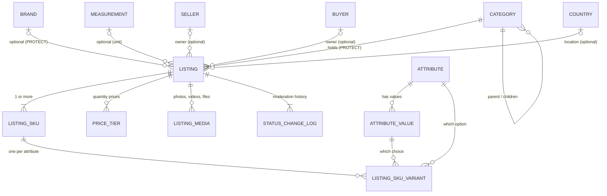
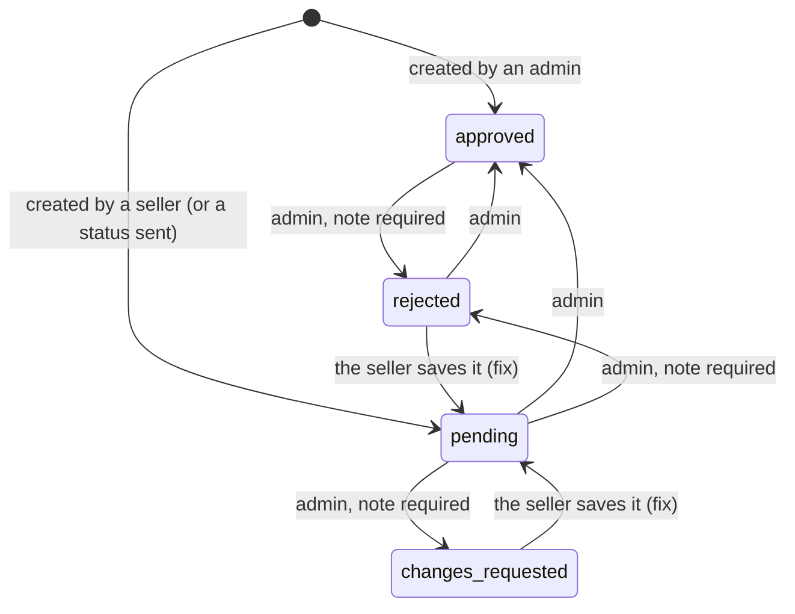

# Listing — the Complete Guide

Everything about listings in one place: what a listing is, what it is connected to
(categories, brands, attributes, SKUs, geography, owners), what you must create first,
how to create every kind of listing, and what happens to it afterwards (media, moderation, edits, delete).
It covers **both sides**: the admin (sections 1-12) and the **seller** who creates and manages their own listings (section 13), and it includes **gigs** (section 14) and the **thumbnail** (section 15).
A plain-language version for everyone, with no API details, is [`Egoola_Listing_Guide.md`](Egoola_Listing_Guide.md).

> **Products, gigs and jobs have separate APIs.** Sections 1–13 are about **products** (`/catalog/listings/`, `/seller/listings/`) and the rules
> every listing shares (SKUs, moderation, change logs). A **gig** (a seller's service offer) has its own endpoints (`/catalog/gigs/`,
> `/seller/gigs/`) and its own price model: **section 14**. The **thumbnail** (cover picture of a product or gig) is **section 15**. A **job** (a
> buyer's request) stays on `/catalog/listings/` until the Job step. The sections say where a rule differs.

This guide explains the whole picture. For the exact request and response of one
topic, the other guides go deeper:

| Topic | Deeper guide |
|---|---|
| Listing endpoints, moderation tables, brand CRUD, the pending list | [listing-module-guide.md](listing-module-guide.md) |
| The seller's listing endpoints and lookups (request / response) | [seller-api-guide.md](seller-api-guide.md) section 6 |
| Attributes, attribute values, SKU rules | [attribute-sku-guide.md](attribute-sku-guide.md) |
| Category tree and parent chain | [category-tree-api-guide.md](category-tree-api-guide.md) |
| Country / state / city / thana | [geography-api-guide.md](geography-api-guide.md) |
| Login, tokens, errors, pagination | [frontend-api-guide.md](frontend-api-guide.md) |
| Postman | `postman/Egoola-Listing.postman_collection.json` (listings, **Gigs**, **Listing files**), `postman/Egoola-Attribute.postman_collection.json` (admin); `postman/Egoola-SellerApp.postman_collection.json` → **Seller listings**, **Seller gigs** (seller) |

Base URL: `http://127.0.0.1:8000/api/v1`. Sections 1-12 are the **admin** product endpoints (`/catalog/...`; gigs: section 14): every call needs
`Authorization: Bearer <admin access token>`; seller and buyer tokens get `403`; no token gets `401`. The **seller** endpoints
(`/seller/listings/...`, section 13; `/seller/gigs/...`, section 14.5) need a seller token instead. The ids in the examples come from the demo
database, yours will differ — always load ids from the list APIs.

---

## 1. The big picture

One **listing** is one thing for sale or one request for work. The same table holds every kind:
the six product formats (`general`, `used`, `village`, `retail`, `wholesale`, `brand`), **gigs** (a seller's service offer) and **jobs**
(requests posted by buyers). (The old app had a separate table for each of them.) Each kind has its own API (see
section 14.1).

A listing does not hold its own price or stock. They live on **SKUs** (sellable combinations; for a gig, one per price type).



In words:

- A listing belongs to **one category** (required), of the same type as the listing (a product needs a product category).
- It may have **one brand**, **one measurement unit**, **one owner** (a seller or a buyer, or neither when an admin creates it) and a **location**.
- It has **one or more SKUs**. Each SKU has its own price, discount and stock, and (when the product has options) a set of
  **variants** such as "Size = M" and "Colour = Red".
- Variants are built from **attributes** (Size, Colour ...) and their **values** (S, M, L ... / Red, Blue ...).
- It may have **price tiers** (cheaper per unit for larger quantities), **media** (photos, videos, documents), and always has a
  **status history**.

### How the parts are connected, and what happens on delete

| From | To | Required? | If you try to delete the target |
|---|---|---|---|
| Listing → Category | `category` | **yes** | blocked, `409` (deactivate the category instead) |
| Listing → Brand | `brand` | only for `listing_type = brand` | blocked, `409` |
| Listing → Measurement | `measurement` | no | allowed; the listing's measurement becomes empty |
| Listing → Seller / Buyer | `seller` / `buyer` | no (never both) | deleting a seller or buyer **deletes their listings** |
| Listing → Country / State / City / Thana | location | no | allowed; the field becomes empty |
| SKU → Listing | `listing` | yes | deleting a listing (soft delete) keeps its SKUs |
| Variant → Attribute / Attribute value | `attribute`, `attribute_value` | yes | blocked, `409` while a SKU uses it (deactivate instead) |
| Attribute value → Attribute | `attribute` | yes | deleting an unused attribute also deletes its values |

### What is *not* connected

- **Attributes are not tied to categories.** Any active attribute can be used on any listing in any category.
  (If you later want "Size only for Fashion", that needs a category-to-attribute link; it does not exist yet.)
- **The measurement unit is not tied to SKUs.** It is one unit for the whole listing (for example `kg`, `pc`).
- **Price tiers are listing-wide** for now (they have an optional `listing_sku` reserved for later).

---

## 2. What to create first (in this order)

Think of it like filling the dropdowns of the "Create listing" screen. Everything on the left must exist before you use it.

| # | You need | Needed when | Where |
|---|---|---|---|
| 1 | **Category** | always | `/catalog/categories/` |
| 2 | **Measurement** (unit) | recommended for products (not for gigs) | `/catalog/measurements/` |
| 3 | **Brand** | only for `listing_type = brand` (optional otherwise) | `/catalog/brands/` |
| 4 | **Attributes + values** | only when the product has options (sizes, colours, ...) | `/catalog/attributes/`, `/catalog/attribute-values/` |
| 5 | **Seller** or **Buyer** | only if the listing should have an owner | `/accounts/sellers/`, `/accounts/buyers/` |
| 6 | **Country / State / City / Thana** | only if the listing has a location | `/geography/...` |

### 2.1 Category

Categories are **one tree for both products and services**.

```
Electronics (product)
├── Mobiles
│   └── Smartphones          <- a listing can use any level
└── Laptops & Computers
Home Services (service)
├── Cleaning
└── Plumbing
```

Create one:
```json
POST /catalog/categories/
{ "type": "product", "name": "Smartphones", "parent": 19, "sort_order": 1, "status": "active" }
```
- `type` (`product` or `service`) and `name` are required. `parent`, `sort_order`, `status` (`active` default / `inactive`) and an `image` (file) are optional.
- The `slug` is made by the server from the name. The same name cannot appear twice **within the same type**.
- A parent must be the **same type** as its child, and a category cannot become its own ancestor (loops are rejected).
- The API has create, update, list (`?type=`, `?status=`, `?search=`) and delete. There is no single-category GET.
- Useful reads: `GET /catalog/categories/tree/?type=product` (the whole tree, not paginated) and
  `GET /catalog/categories/parent-chain/?categoryIds=38` (breadcrumb: `Electronics > Mobiles > Smartphones`).
- The table also has a Bangla name column (`nameBn`), but the category API does not accept it yet.

**Category rules for a listing**

1. The category's `type` must equal the listing's `catalog_type`. A service category cannot hold a product:
   `{"category": ["This is a service category; a product listing needs a product category."]}`
2. The category must be **active** when you choose it: `{"category": ["This category is inactive."]}`.
   (If it is deactivated *later*, the listing stays and can still be edited.)
3. Any level works: you can use a parent category or a leaf. Using the most specific one (a leaf) is best for browsing.
4. A category that listings use cannot be deleted. `DELETE` returns `409`
   `{"detail": "This category, or one of its sub-categories, is used by one or more listings. Deactivate it instead of deleting."}`.

### 2.2 Measurement

The unit of the product: `Piece (pc)`, `Kilogram (kg)`, `Litre (L)`, `Box (box)` ...
```json
POST /catalog/measurements/   { "name": "Kilogram", "symbol": "kg" }
```
Listing field: `measurement` (id). Optional. It is only a label for stock and price ("per kg"); it does not change any calculation.

### 2.3 Brand

A simple admin-managed list (`name`, `is_active`). Listings **pick** a brand from it, they never type one.
```json
POST /catalog/brands/   { "name": "Samsung" }
```
- A listing with `listing_type = "brand"` **must** have a `brand`. Any other type may have one.
- A newly chosen brand must be active (an already-attached brand that is deactivated later does not block edits).
- A brand used by any listing (even a soft-deleted one) cannot be deleted: `409`. Deactivate it.

### 2.4 Attributes and values

Only needed when one product comes in options (see section 5 for how they become SKUs).
```json
POST /catalog/attributes/         { "name": "Size", "name_bn": "সাইজ" }
POST /catalog/attribute-values/   { "attribute": 21, "name": "XL" }
```
- English name required, Bangla name optional, `is_active` defaults to true.
- A value belongs to one attribute and keeps it forever. The same value name is allowed under another attribute.
- Full field list and endpoints: [attribute-sku-guide.md](attribute-sku-guide.md).

### 2.5 Owner (seller or buyer)

| Listing kind | `posted_by_role` | Owner field |
|---|---|---|
| A seller's offer (product or service) | `seller_offer` | `seller` |
| A buyer's job request | `buyer_request` | `buyer` |
| Created by the admin, no owner | leave out | neither |

- Never both a `seller` and a `buyer`.
- `seller_offer` cannot have a `buyer`; `buyer_request` cannot have a `seller`.

### 2.6 Location

Optional: `country`, `state`, `city`, `thana` (ids). They must be **on one branch of the geography tree**: the state belongs to the country, the city to the state, the thana to the city.
Any level can be left out. Example: country 126 (Bangladesh), state 13 (Chittagong), city 8 (Feni). Using state 12 (Dhaka) with city 8 is rejected:
`{"city": ["This city does not belong to the selected state."]}`.

---

## 3. Product, gig or job? Which fields apply

| | Product (`catalog_type = "product"`) | Gig (`service` + `seller_offer`) | Job (`service` + `buyer_request`) |
|---|---|---|---|
| Admin endpoint | `/catalog/listings/` | `/catalog/gigs/` | `/catalog/listings/` (for now) |
| Category type | product | service | service |
| `listing_type` | `general` `used` `village` `retail` `wholesale` `brand` | not used | not used |
| `posted_by_role` | `seller_offer` or empty | always `seller_offer` (set by the endpoint) | `buyer_request` |
| Product-side fields | `brand`, `model`, `origin`, `warranty`, `measurement`, `min_order_qty`, `condition_note`, `attributes` (free-form specs), `price_tiers` | refused (`400`) | refused (`400`) |
| Service-side fields | refused (`400`) | `delivery_days`, `urgent`, `package_includes`, `available_from`, `available_to` | the same |
| SKUs | options (Size, Colour ...), price, discount, **stock** | **one per price type**: `price_type`, price, discount, description. No options, no stock | one default SKU (the budget); `price_type` optional |

Details for gigs: section 14. A seller's service offer sent to `/catalog/listings/` is `400`
(`"A seller's service offer is a gig: use the gig endpoints"`), a product with `posted_by_role = buyer_request` is `400`, and
`catalog_type` / `posted_by_role` cannot be changed after creation.

The meaning of the six product formats: `general` (normal shop item), `used` (second-hand: use `condition_note`),
`village` (local/village produce or handmade), `retail`, `wholesale` (bulk, use price tiers and `min_order_qty`), `brand` (a branded product: `brand` required).

`attributes` on a listing is a free-form JSON object for specs that are **not** options a buyer picks
(for example `{"ram": "6GB", "network": "4G"}`). Do not confuse it with **Attributes** (Size, Colour): those are real options and become SKUs.

---

## 4. Creating a listing — step by step

All of these are `POST /catalog/listings/`. A listing created by an admin is **approved** immediately unless you send a `status`.

### 4.1 The simplest listing (no options, no owner)

A product that has one price and no sizes/colours. Send `price`; the server makes one default SKU for you.

```json
{
  "category": 18,
  "catalog_type": "product",
  "title": "USB-C Charger 20W",
  "description": "Fast charger with cable.",
  "price": "900.00",
  "stock_qty": 40
}
```
Required: `category`, `catalog_type`, `title`, `description`, and either `price` or `skus`.

`price` here is a shortcut. It also accepts `discounted_price`, `discount_start_date`, `discount_end_date`, `stock_qty` and `sku` (a product code).
The response has `skus` with the one SKU, and the listing's own `price` / `discounted_price` repeat it.

### 4.2 A product with options (sizes, colours, storage ...)

1. Make sure the **attributes and values exist** (section 2.4).
2. Decide which attributes this product uses (say Size and Colour) and which values.
3. Send **one SKU per combination**, each with its own price, discount and stock.

```json
{
  "category": 22,
  "catalog_type": "product",
  "listing_type": "general",
  "posted_by_role": "seller_offer",
  "seller": 7,
  "title": "Men's Cotton Panjabi",
  "description": "Soft cotton with embroidery.",
  "measurement": 8,
  "country": 126, "state": 13, "city": 8,
  "skus": [
    { "sku": "PNJ-M-WHT", "price": "1800.00", "discounted_price": "1500.00", "stock_qty": 12,
      "variants": [ { "attribute": 21, "attribute_value": 33 }, { "attribute": 22, "attribute_value": 56 } ] },
    { "sku": "PNJ-L-WHT", "price": "1900.00", "stock_qty": 8,
      "variants": [ { "attribute": 21, "attribute_value": 34 }, { "attribute": 22, "attribute_value": 56 } ] }
  ]
}
```
(Attribute 21 = Size, 22 = Colour; value 33 = M, 34 = L, 56 = White.)

The rules for SKUs (full list in the attribute guide):
- Every SKU must use **the same attributes** (all Size + Colour — not one SKU with only Size).
- **No two SKUs** with the same combination.
- A variant's value must belong to its attribute, and a newly chosen attribute/value must be active.
- SKU codes (`sku`) are unique across the whole system.
- `skus` and the `price` shortcut cannot be sent together.

### 4.3 A branded product

```json
{
  "category": 38, "catalog_type": "product", "listing_type": "brand", "posted_by_role": "seller_offer", "seller": 7,
  "brand": 12, "model": "SM-A155F", "warranty": "1 year",
  "title": "Samsung Galaxy A15", "description": "6.5-inch AMOLED, 50MP camera.",
  "measurement": 8, "attributes": { "network": "4G" },
  "skus": [
    { "sku": "SAM-A15-128-BLK", "price": "24500.00", "discounted_price": "22900.00", "stock_qty": 25,
      "variants": [ { "attribute": 23, "attribute_value": 66 }, { "attribute": 22, "attribute_value": 55 } ] }
  ]
}
```
`brand` is mandatory when `listing_type` is `brand`: `{"brand": ["A brand listing must select a brand."]}`.

### 4.4 A wholesale product with quantity prices

Quantity prices are **tiers** and apply to the whole listing:
```json
"price_tiers": [
  { "min_qty": 10,  "max_qty": 49,   "price": "750.00", "discounted_price": "720.00" },
  { "min_qty": 50,  "max_qty": 199,  "price": "750.00", "discounted_price": "690.00" },
  { "min_qty": 200, "max_qty": null, "price": "750.00", "discounted_price": "650.00" }
]
```
- `min_qty` / `max_qty` at least 1, `max_qty` not below `min_qty`; `max_qty: null` means "and above".
- Tiers must not overlap, and only the last tier may be open-ended.
- Sending `price_tiers` **replaces the whole list**; sending `[]` clears it; leaving the key out on an update keeps the tiers.
- A tier may carry `listing_sku` (one of this listing's SKU ids) — optional, reserved for later.
- Add `min_order_qty` (at least 1) for wholesale.

### 4.5 A service: it is a gig

A seller's service offer is a **gig** and is created with `POST /catalog/gigs/` (admin) or `POST /seller/gigs/` (seller), not here. A gig is
priced by packages (one SKU per price type; the buyer chooses the duration when ordering) and has no options, stock or quantity prices. Full guide:
section 14.

### 4.6 A buyer's job request

```json
{
  "category": 30, "catalog_type": "service", "posted_by_role": "buyer_request", "buyer": 4,
  "title": "Need a plumber for bathroom pipe repair", "description": "Leaking pipe under the basin.",
  "price": "1500.00", "price_type": "hourly", "urgent": true, "delivery_days": 1
}
```
Here `price` is the buyer's budget (one default SKU, with an optional `price_type`). Do not send a `seller`. A job request has no product
fields (`brand`, `model`, `listing_type`, ...) and no SKU `description`.

### 4.7 Photos, videos and the thumbnail

Create and update are **JSON only** (multipart is `415`). Pictures and videos have their own API, used after the listing exists:
`POST` / `PATCH /catalog/listing-files/{id}/` (admin) and `/seller/listing-files/{id}/` (seller). It works for a product id or a gig id.
Full rules, fields and errors: **section 15**.

### 4.8 Choosing the status when you create

| You send | Result |
|---|---|
| nothing (admin) | `approved` |
| `"status": "pending"` | waits for moderation |
| `"status": "rejected"` or `"changes_requested"` | needs a `note` too |

A future seller self-service create will default to `pending`.

---

## 5. Prices, discounts, stock — how SKUs work

A **SKU** is one sellable combination. Price, discount and stock belong to it.

| SKU field | Meaning |
|---|---|
| `price` | the original price (required for a new SKU, not negative) |
| `discounted_price` | the price charged while the discount runs. Empty → equals `price` (never empty in the response). Never above `price` |
| `discount_start_date` / `discount_end_date` | when the discount runs. Empty = no limit on that side. End must be after start |
| `stock_qty` | units in stock. Empty = not tracked. `0` = out of stock. (A gig SKU must leave it empty.) |
| `price_type`, `description`, `description_bn` | **gig SKUs only** (see section 14.3); on a product SKU they are `400` |
| `reserved_qty` | read only, units held for open orders (the order flow fills it later) |
| `is_active` | `false` hides the SKU from buyers. SKUs are **never deleted** |
| `variants` | the options of this SKU (`[]` for a listing without options) |
| `effective_price`, `is_discount_active` | read only. What the buyer pays **right now** and whether the discount applies right now |

**Discount window.** Outside the window the buyer pays `price`, even though `discounted_price` is stored.
Example: price 1900, discounted 1500, window 1–31 Oct. On 15 Oct → `effective_price` 1500; on 5 Nov → 1900.
Dates need a `discounted_price` lower than `price`.

**The listing-level `price` and `discounted_price`** are read-only: the original and the current price of the **cheapest active SKU**
("from 1,500"). They are `null` when no SKU is active. Use them on list pages.

**Changing SKUs later** (`PATCH` with `skus`): an item with an `id` changes that SKU (only the fields you send); an item without an `id`
adds a SKU; SKUs you leave out are untouched. To retire a SKU send `{"id": 41, "is_active": false}`. A plain `price` or `stock_qty` on update is rejected:
`{"price": "Prices and stock are changed through `skus`."}`.

**What to do with a stock of "5 Blue / M, 0 Blue / L":** that is two SKUs with `stock_qty` 5 and 0. The storefront shows L as sold out.

---

## 6. The complete field reference

### 6.1 Listing fields (create and update)

| Field | Type | Required | Notes |
|---|---|---|---|
| `category` | id | **yes** | active, same type as `catalog_type` |
| `catalog_type` | `product` \| `service` | **yes** | `product`, or `service` only together with `posted_by_role = buyer_request` (a job). A gig is created on `/catalog/gigs/`. Cannot be changed later |
| `title` | text | **yes** | the slug is made from it. Extra spaces are tidied. **Unique per seller** (see section 9) |
| `title_bn` | text | no | Bangla title |
| `description` | text | **yes** | |
| `description_bn` | text | no | Bangla description |
| `listing_type` | `general` `used` `village` `retail` `wholesale` `brand` | no | products; `brand` needs `brand` |
| `posted_by_role` | `seller_offer` \| `buyer_request` | no | must match the owner. A `service` needs `buyer_request` here; a `product` cannot be a `buyer_request`. Cannot be changed later |
| `seller` / `buyer` | id | no | never both |
| `brand` | id | only for `brand` listings | active when newly chosen |
| `model`, `origin`, `warranty` | text | no | |
| `origin_bn`, `warranty_bn` | text | no | Bangla versions |
| `currency` | text | no | default `BDT` |
| `measurement` | id | no | |
| `min_order_qty` | integer ≥ 1 | no | |
| `condition_note` | text | no | for used products |
| `condition_note_bn` | text | no | Bangla version |
| `attributes` | JSON object | no | free-form specs, not options |
| `delivery_days` | integer ≥ 0 | no | jobs only (refused on a product) |
| `urgent` | true / false | no | jobs only |
| `package_includes`, `package_includes_bn` | text | no | jobs only |
| `available_from`, `available_to` | date-time | no | jobs only |
| `country`, `state`, `city`, `thana` | ids | no | one branch of the tree |
| `status` | see section 8 | no | default `approved` (admin). A listing a **seller** creates is always `pending` |
| `note` | text | when rejecting / asking changes | only read with a status change |
| `skus` | list | **yes on create** (or `price`) | section 5 |
| `price`, `discounted_price`, `discount_start_date`, `discount_end_date`, `stock_qty`, `sku`, `price_type` | — | create only | shortcut for one default SKU (`price_type` only for a gig or a job) |
| `price_tiers` | list | no | whole-list replace |

### 6.2 What comes back

`id`, `seller`, `buyer`, `category`, `catalog_type`, `listing_type`, `posted_by_role`, `title`, `title_bn`, `slug`, `description`, `description_bn`, `image_path`, `image_url` (the thumbnail, read only), `brand`, `brand_name`,
`model`, `origin`, `origin_bn`, `warranty`, `warranty_bn`, `price`, `discounted_price` (read only, cheapest active SKU), `currency`, `skus`,
`delivery_days`, `urgent`, `package_includes`, `package_includes_bn`, `available_from`, `available_to`, `min_order_qty`, `measurement`, `condition_note`, `condition_note_bn`, `attributes`,
`country`, `state`, `city`, `thana`, `status`, `note`, `requested_at`, `price_tiers`, `media`, `status_change_logs`, `info_change_logs`, `created_at`, `updated_at`.
`requested_at` is read only: when the listing joined the pending list (section 8). `info_change_logs` is the content change history (section 9).

One SKU in the response:
```json
{
  "id": 106, "sku": "SAM-A15-128-BLK",
  "price": "24500.00", "discounted_price": "22900.00",
  "discount_start_date": "2026-10-06T15:28:16+06:00", "discount_end_date": "2026-10-31T15:28:16+06:00",
  "effective_price": "22900.00", "is_discount_active": true,
  "stock_qty": 25, "reserved_qty": 0, "is_active": true,
  "price_type": null, "description": null, "description_bn": null,
  "variants": [
    { "attribute": 22, "attribute_name": "Colour",  "attribute_value": 55, "attribute_value_name": "Black" },
    { "attribute": 23, "attribute_name": "Storage", "attribute_value": 66, "attribute_value_name": "128GB" }
  ]
}
```

---

## 7. Reading listings

| Call | Notes |
|---|---|
| `GET /catalog/listings/` | light rows: `id, title, title_bn, slug, catalog_type, listing_type, posted_by_role, category, brand, seller, buyer, price, discounted_price, image_url, status, requested_at, created_at`. Products and job requests only (gigs are on `/catalog/gigs/`) |
| `GET /catalog/listings/{id}/` | full detail with SKUs, variants, tiers, media, thumbnail, **status history** and **info change history**. A gig id is `404` |
| `GET /catalog/listings/requests/` | the **pending list** (products and jobs): listings waiting for a decision (section 8). Gigs have `/catalog/gigs/requests/` |

List filters: `?status=`, `?catalog_type=`, `?listing_type=`, `?category=`, `?brand=`, `?seller=`, `?buyer=`,
`?created_from=` / `?created_to=` and `?requested_from=` / `?requested_to=` (dates, `YYYY-MM-DD`, inclusive),
`?search=` (title, Bangla title, brand name, model, SKU code), `?limit=`, `?offset=` (default 20, max 100).
A soft-deleted or unknown listing is `404`.

For a breadcrumb on the detail page, call `GET /catalog/categories/parent-chain/?categoryIds=<category id>`.

---

## 8. After creation: moderation

Every listing has a **status**:


(An admin can move a listing between any statuses with a `PATCH`; the arrows show the normal flow. An **approved** listing a seller edits
**stays approved**: sellers never send an approved listing back to review.)

| Status | Meaning |
|---|---|
| `draft` | not submitted yet |
| `pending` | waiting for an admin |
| `approved` | visible to buyers |
| `rejected` | refused — a note explains why |
| `changes_requested` | sent back for edits — a note says what to change |

Rules (the same as for seller verification):
- `rejected` and `changes_requested` need a **note**: `{"note": ["A note is required when rejecting a listing or requesting changes."]}`.
- The **note belongs to the status change.** It is read only when the status really changes; any other `note` is ignored.
  `note` on the listing always equals the note of the **latest** change, and is cleared (`null`) when you change status without one.
- Every status change adds a row to `status_change_logs` (newest first): the status, the note, who did it (`created_by`, `creator_type`, `creator_name`) and when. Creating a listing writes the first row.
- Re-sending the status the listing already has is not a change: no history row, no note needed.
- **`requested_at`** is when the listing joined the pending list. It is set when a seller creates a listing, and again every time a
  `rejected` or `changes_requested` listing goes back to `pending` (the seller saving it, or an admin setting `pending`). Admin-created
  approved listings have `requested_at: null`.

### The pending list (admin)

`GET /catalog/listings/requests/` lists only `status = pending`, **newest request first**, with **cursor pagination** (follow `next` /
`previous` exactly as given; there is no `count`). It takes the list filters (`seller`, `catalog_type`, `listing_type`, `category`, `brand`,
`created_*`, `requested_*`, `search`) and `ordering` (`requested_at`, `created_at`, `title`, `id`; `-` reverses). A resubmitted listing shows
up at the top again. For a menu badge use `GET /catalog/listings/?status=pending&limit=1` and read `count`. This list holds products and job
requests; the pending **gigs** are on `GET /catalog/gigs/requests/` (badge: `GET /catalog/gigs/?status=pending&limit=1`), so the menu has one
number for Listings and one for Gigs.

Moderate one: `PATCH /catalog/listings/{id}/` with `{"status": "rejected", "note": "Photos are low quality"}`.

Moderate many: `POST /catalog/listings/bulk-moderate/` (only products and job requests are touched; gigs have `POST /catalog/gigs/bulk-moderate/`)
```json
{ "listing_ids": [31, 32, 33], "status": "approved", "note": null }
```
Only `approved`, `rejected`, `changes_requested` are allowed here. The answer lists `updated` and `skipped` (already in that status) in the order you sent them. It is all-or-nothing.

---

## 9. Editing and deleting

`PATCH /catalog/listings/{id}/` changes only what you send. A quick summary:

| Goal | Send |
|---|---|
| Edit text, brand, category, location ... | the field(s) |
| Change a price / discount / stock | `skus` with the SKU `id` |
| Add a size/colour combination | `skus` item without `id`, with `variants` |
| Hide a combination | `skus` item `{"id": .., "is_active": false}` |
| Replace quantity prices | `price_tiers` (whole list) |
| Add / remove photos and videos | the listing-files API: `PATCH /catalog/listing-files/{id}/` (section 15) |
| Set / replace / remove the thumbnail | the same call (section 15) |
| Change status | `status` (+ `note`) |

If you change `title`, the `slug` is regenerated. **A seller cannot have two live listings of the same type (product or service) with the same title** (upper / lower case and extra
spaces do not matter; a seller may have a product and a gig with the same title): the API answers `400` `{"title": ["This seller already has a listing with this title. Update that listing instead. (listing #123)"]}`
(for a seller using their own endpoint the message starts with "You already have a listing..."). It applies to admin-created listings that name a
seller too, and when an admin moves a listing to a seller who already has that title. Listings with no seller and buyer requests are not affected,
and a **deleted** listing frees its title.
 `catalog_type` and `posted_by_role` cannot be changed (`400`). A new `category` is checked again (type match, active category).
Every update stamps `updated_by` / `updated_at`.

**Info change log.** Every save that really changes a listing's content adds one row to `info_change_logs` (newest first), by the seller or by an
admin: `changed_fields`, `previous_data` and `new_data` (same keys, only what changed), and who / when (`created_by`, `creator_type`, `creator_name`,
`created_at`). Tracked: all text and Bangla fields, category, brand, measurement, owner, location, job details, `attributes`, the thumbnail, and three groups
shown as whole lists before and after: `price_tiers`, `skus` (price, discount, discount dates, `is_active`, options, and for a gig the price type and descriptions; **not** stock) and `media`.
Places and brand show as `{"id": .., "name": ..}`. Status changes are not here (see `status_change_logs`). Saving the same values writes nothing.


**Delete** (`DELETE /catalog/listings/{id}/`) is a **soft delete**: `204`, and the listing disappears from every list and detail call, but the row, its SKUs and its history stay. Its slug and SKU codes stay reserved. The **thumbnail file is deleted** (`image_path` / `image_url` become `null`); gallery files stay.
There is no restore endpoint yet.

---

## 10. Common errors

| What went wrong | Response |
|---|---|
| no `skus` and no `price` | `400` `{"skus": ["A listing needs at least one SKU: send `skus`, or `price` for a single default SKU."]}` |
| `skus` and `price` together | `400` `{"skus": "Send either `skus` or the price shortcut, not both."}` |
| `price` / `stock_qty` on an update | `400` `{"price": "Prices and stock are changed through `skus`."}` |
| category of the wrong type | `400` `{"category": ["This is a service category; a product listing needs a product category."]}` |
| a seller's service offer on the listing endpoint | `400` `{"catalog_type": ["A seller's service offer is a gig: use the gig endpoints (/catalog/gigs/). ..."]}` |
| a service-only field on a product (`delivery_days`, `urgent`, ...), or a gig SKU field (`price_type`, `description`) on a product SKU | `400` on the field (`"Only for gigs and job requests."` / `"Only for gigs."`) |
| a product-only field on a job request (`brand`, `model`, `listing_type`, ...) | `400` `{"brand": "Not available for a job request."}` |
| a product with `posted_by_role = buyer_request` | `400` `{"posted_by_role": "A product cannot be a buyer_request."}` |
| changing `catalog_type` or `posted_by_role` | `400` `"Cannot be changed after the listing is created."` |
| a gig id on a product endpoint (or the reverse) | `404` |
| inactive category / brand | `400` `{"category": ["This category is inactive."]}` / `{"brand": ["This brand is inactive."]}` |
| `listing_type: brand` without `brand` | `400` `{"brand": ["A brand listing must select a brand."]}` |
| both `seller` and `buyer` | `400` `{"buyer": ["A listing cannot have both a seller and a buyer."]}` |
| owner does not match `posted_by_role` | `400` on `buyer` / `seller` |
| city not in the chosen state | `400` `{"city": ["This city does not belong to the selected state."]}` |
| negative price / stock | `400` on the field |
| discount above price | `400` `{"skus": {"0": {"discounted_price": "Cannot be higher than price (price is the original price)."}}}` |
| two SKUs with one combination | `400` `{"skus": ["Every SKU of a listing needs its own combination of options (two SKUs have the same one)."]}` |
| SKUs using different attributes | `400` `{"skus": ["All SKUs of a listing must use the same attributes (e.g. all Size + Colour)."]}` |
| SKU code already used | `400` `{"skus": {"0": {"sku": "A SKU with this code already exists."}}}` |
| overlapping price tiers | `400` `{"price_tiers": ["Price tier quantity ranges must not overlap, and only the last tier can have no max_qty."]}` |
| the seller already has a listing of that type with that title | `400` `{"title": ["This seller already has a listing with this title. Update that listing instead. (listing #123)"]}` |
| reject without a note | `400` `{"note": ["A note is required when rejecting a listing or requesting changes."]}` |
| delete a used category / brand / attribute / value | `409` with a message to deactivate it instead |
| seller or buyer token | `403` · no token `401` |

---

## 11. A checklist for the admin "Create listing" screen

1. **Kind:** this form is for **products** (and, for now, job requests: service + `buyer_request`). A gig has its own form: section 14. Then choose `listing_type` (products).
2. **Category:** show the tree (`/categories/tree/?type=<kind>`), only active ones, and send the chosen id.
3. **Brand** (required for `brand`), **measurement**, **model / origin / warranty** (products), or **delivery / urgent** (job requests).
4. **Owner:** a seller (offer) or a buyer (request), or none.
5. **Location:** cascading dropdowns (country → state → city → thana), each filtered by the one above.
6. **Options?** If yes, pick attributes and values (`/attributes/?is_active=true`, values come with each attribute), generate every combination as a row with
   `sku` code, `price`, `discounted_price`, discount dates, `stock_qty`, and send them as `skus`. If no, show one price box and send `price` (+ stock).
7. **Quantity prices** (wholesale): a small table → `price_tiers`.
8. **Files:** the thumbnail and the gallery are separate multipart calls after saving (`POST` / `PATCH .../listing-files/{id}/`, section 15). Create and update are JSON only.
9. **Status:** leave the default, or choose `pending`.
10. On the **edit** screen, load `GET /listings/{id}/`, send back only what changed, with SKU ids.

---

## 12. Quick answers

- *Do I create a product per size/colour?* No. One listing, one SKU per combination.
- *Where is the price?* On the SKUs. The listing shows the cheapest active one as "from".
- *Can I delete a SKU?* No, hide it with `is_active: false`.
- *Can I use any attribute in any category?* Yes. Attributes are not tied to categories.
- *Is the category required?* Yes, and it must match the listing type and be active.
- *Do services use SKUs?* Yes. Every listing has at least one SKU. A gig has one SKU per price type (hourly, daily, ...), with no options or stock; the buyer chooses the duration when ordering.
- *Where do I create a service?* As a gig: `/catalog/gigs/` (admin) or `/seller/gigs/` (seller).
- *Where is the cover picture?* `image_path` / `image_url`, set with `POST` / `PATCH /catalog/listing-files/{id}/` (not in create or update).
- *Where does the order flow come in?* Cart items and order items already have a `listingSkuId`; the order APIs are not built yet.
- *What if I delete a listing?* It is hidden (soft delete); everything is kept.

---

## 13. Sellers: creating and managing their own listings

A seller who is **verified and active** manages their own **products** through one shared set of endpoints, for every product format
(`general`, `used`, `village`, `retail`, `wholesale`, `brand`). Their **gigs** (services) are on `/seller/gigs/`
(section 14.5). Full request and response examples are in
[seller-api-guide.md](seller-api-guide.md) section 6; the rules are:

| Call | What it does |
|---|---|
| `POST /seller/listings/` | create a listing. It is **always `pending`**, owned by the seller, `posted_by_role = seller_offer` |
| `GET /seller/listings/` | my listings, with filters (below) |
| `GET /seller/listings/{id}/` | one of my listings: full detail, SKUs, tiers, media, **status history** (not the info change log) |
| `PATCH` / `PUT /seller/listings/{id}/` | edit it |
| `POST` / `PATCH /seller/listing-files/{id}/` | add, replace or remove the thumbnail, and add or remove gallery files (section 15) |
| `GET /seller/lookups/categories/`, `/brands/`, `/measurements/`, `/attributes/` | read-only lists to fill the form (only active ones) |
| `DELETE` | **not allowed** (`405`). Only an admin can delete a listing |

Use a seller token. A seller who is still waiting for approval, was rejected, or is paused gets `403` with a message that says which.
A seller never sees another seller's listing (`404`), an admin-owned listing, a buyer request, or their own gig (`404` here; it is on `/seller/gigs/`).
`catalog_type` is not needed (it is always `product`); `catalog_type: "service"` is `400`.

**What a seller can send.** The same product fields as the admin (section 6.1) except `seller`, `buyer`, `posted_by_role`, `status` and `requested_at`:
they are not accepted (sending them changes nothing). The service-only fields (`delivery_days`, `urgent`, `package_includes`, ...) and the gig SKU
fields (`price_type`, `description`) are `400` on a product. The seller can attach media, price tiers and SKUs exactly like an admin.

**What happens when a seller edits:**

| Listing is | A seller's save (PATCH or PUT, even an empty one) does |
|---|---|
| `pending` | stays `pending`; `requested_at` unchanged |
| `approved` | stays `approved`, **whatever changes** (content, SKUs, prices, stock, thumbnail). The edit is written to the info change log for the admin |
| `rejected` or `changes_requested` | goes back to **`pending`**, `requested_at` = now (top of the admin's pending list). There is no separate Resubmit button: saving the listing is resubmitting (a files change is not) |

For a rejected listing the seller reads the admin's reason in `note`. A `note` sent when saving a rejected / changes-requested listing becomes the
seller's message to the reviewer (an empty or missing note clears it); in any other state a `note` is ignored. The admin's reason is kept in
`status_change_logs`, which the seller can read.

**Same title.** A seller cannot create a second product with a title they already have (a gig with the same title is allowed). If an earlier listing with that title was **rejected**,
the seller must update that listing instead (the error names it: "listing #123"). Nobody can create a duplicate by deleting, because sellers
cannot delete.

**My list filters:** `?status=`, `?listing_type=`, `?category=`, `?brand=`, `?created_from=` / `?created_to=`,
`?requested_from=` / `?requested_to=`, `?search=` (title, Bangla title, SKU code, brand name), `?ordering=` (`created_at`, `updated_at`, `requested_at`,
`title`, `status`, `id`; `-` reverses; default newest first), `?limit=` / `?offset=`. Rows: `id, title, title_bn, slug, catalog_type, listing_type,
category, brand, price, discounted_price, image_url, status, note, requested_at, created_at, updated_at`.

**Checklist for the seller "Create listing" screen:** same as section 11, except: no owner and no status choice (it is always mine and pending); fill the
dropdowns from `/seller/lookups/...` (categories filtered by `type`, brands, measurements, attributes with their values) and the public geography lists;
show the Bangla fields next to the English ones; after saving, offer the thumbnail upload (a separate step); show the status ("Waiting for review"); on a rejected listing show the reason and let the seller
edit and save.

**Admin's view of seller listings.** Nothing new to call: a seller's listing is an ordinary listing with `seller` set and `posted_by_role = seller_offer`.
New ones arrive in the pending list; approve or reject with `PATCH` or `bulk-moderate`; read the seller's changes in `info_change_logs`.

---

## 14. Gigs (a seller's service offers)

A **gig** is a service a seller offers (cleaning, photography, repair). Gigs are rows of the same `listings` table, but they have their own endpoints
and their own price model. This section is the complete gig reference: admin and seller endpoints, packages, errors, the order and cart changes and the
database changes. The plain-language version is in [`Egoola_Listing_Guide.md`](Egoola_Listing_Guide.md) section 12. Postman: `Egoola-Listing` →
**Gigs** and **Listing files** (admin), `Egoola-SellerApp` → **Seller gigs** (seller). Smoke tests: `scripts/smoke/gig_smoke.py` (admin side), `scripts/smoke/listing_files_smoke.py` (files),
`scripts/smoke/seller_gig_smoke.py` (seller side).

### 14.1 Product, gig, job: three kinds, three APIs

All three are rows of the one `listings` table. Each kind has its own endpoints; a row of another kind is a **404** there.

| Kind | How to tell | Admin API | Seller API |
|---|---|---|---|
| **Product** | `catalog_type = product` | `/catalog/listings/` | `/seller/listings/` |
| **Gig** (a seller's service offer) | `catalog_type = service` and `posted_by_role = seller_offer` | `/catalog/gigs/` | `/seller/gigs/` |
| **Job** (a buyer's request for work) | `catalog_type = service` and `posted_by_role = buyer_request` | `/catalog/listings/` for now (the Job step will give it its own API) | not built yet |

What the server checks, on every call:

- The endpoint decides the kind. On `/catalog/gigs/` and `/seller/gigs/`, `catalog_type` is always `service` and `posted_by_role` is always
  `seller_offer`: you do not need to send them (sending them is fine when they match; a different value is `400`).
- `catalog_type` and `posted_by_role` **cannot be changed** after the listing is created (`400`).
- `/catalog/listings/` refuses a seller's service offer: `400 {"catalog_type": ["A seller's service offer is a gig: use the gig endpoints (/catalog/gigs/). ..."]}`.
  It also refuses a product with `posted_by_role = buyer_request`.
- Fields of another kind are refused with `400` (an empty value is fine). On a gig: `listing_type`, `brand`, `model`, `origin`, `origin_bn`,
  `warranty`, `warranty_bn`, `measurement`, `min_order_qty`, `condition_note`, `condition_note_bn`, `attributes`, `price_tiers`:
  `{"brand": "Not available here."}`. On a product: `delivery_days`, `urgent`, `package_includes`, `package_includes_bn`, `available_from`,
  `available_to`, and the gig SKU fields (14.3).
- A gig id on a product endpoint (or the other way round) is `404`, for `GET`, `PATCH` and `DELETE`. The listing-files API takes both kinds.

### 14.2 What a gig is

A gig is a service a seller offers (cleaning, photography, repair). It has the same moderation as any listing (`pending → approved /
rejected / changes_requested`, a note when rejecting, the status history, the info change log, the pending list, bulk moderation) and the
same fields as a service listing, but it is **priced differently**: not by options and stock, but by **packages**, one per **price type**.

| Gig field (on the gig) | Notes |
|---|---|
| `category` | **required**, active, a **service** category |
| `title`, `description` | **required**. `title_bn`, `description_bn` optional |
| `delivery_days`, `urgent`, `package_includes`, `package_includes_bn`, `available_from`, `available_to` | optional service details |
| `country`, `state`, `city`, `thana` | optional, one branch of the geography tree |
| `currency` | default `BDT` |
| `skus` | **the packages** (14.3). At least one on create |
| `seller` | admin only, optional (a gig can have no owner when an admin creates it) |
| `status`, `note` | admin only. A seller's gig is always `pending` on create |
| `image_path`, `image_url`, `media` | the thumbnail and the gallery, **read only here** (section 15) |

### 14.3 Packages: gig SKUs

A gig has **no options, no stock, no quantity prices**. Its price lives on its SKUs, and each SKU is a pricing strategy. **A SKU has no duration**:
the buyer chooses how many hours, days, weeks or months to buy when ordering (`orderItems.duration`, 14.7).

| SKU field | Gig rule |
|---|---|
| `price_type` | **required**: `hourly`, `daily`, `weekly`, `monthly` or `fixed` (a one-off price). `price` is the rate for that unit |
| `price`, `discounted_price`, `discount_start_date`, `discount_end_date` | as for any SKU (discounted price never above price, a window needs a lower discounted price) |
| `description`, `description_bn` | optional text about this package (**gigs only**) |
| `stock_qty` | **must be empty**: a gig has no stock (`400` otherwise) |
| `variants` | **must be empty**: a gig has no options (`400` otherwise) |
| `sku` (code) | optional, unique across all SKUs |
| `is_active` | `false` hides a package. SKUs are never deleted |
| read only | `effective_price` (the rate right now), `is_discount_active`, `reserved_qty` (0) |

**Several pricing strategies = several SKUs**: hourly 500 and weekly 12,000 are two SKUs. **A gig has at most one SKU per price type**
(also enforced by the database). A hidden SKU still holds its price type: reactivate it instead of adding a new one.

```json
POST /api/v1/catalog/gigs/
{ "category": 29, "title": "Home Deep Cleaning", "title_bn": "হোম ক্লিনিং",
  "description": "Full-home cleaning by a team of 3.", "delivery_days": 2, "package_includes": "Floors, kitchen, bathrooms",
  "skus": [
    { "price": "500", "discounted_price": "450", "price_type": "hourly",
      "description": "Hourly cleaning", "description_bn": "ঘণ্টাভিত্তিক ক্লিনিং" },
    { "price": "12000", "price_type": "weekly" },
    { "price": "9000", "price_type": "fixed" } ] }
```

`201` (shortened; an admin-created gig is `approved`, `seller` is `null` when not sent):

```json
{ "id": 183, "seller": null, "category": 29, "catalog_type": "service", "posted_by_role": "seller_offer",
  "title": "Home Deep Cleaning", "slug": "home-deep-cleaning", "image_path": null, "image_url": null,
  "price": "500.00", "discounted_price": "450.00", "currency": "BDT",
  "skus": [
    { "id": 212, "price": "500.00", "discounted_price": "450.00", "effective_price": "450.00", "is_discount_active": true,
      "price_type": "hourly", "stock_qty": null, "reserved_qty": 0, "is_active": true,
      "description": "Hourly cleaning", "description_bn": "ঘণ্টাভিত্তিক ক্লিনিং", "variants": [], "...": "..." },
    { "id": 213, "price": "12000.00", "price_type": "weekly", "...": "..." },
    { "id": 214, "price": "9000.00", "price_type": "fixed", "...": "..." } ],
  "delivery_days": 2, "package_includes": "Floors, kitchen, bathrooms",
  "status": "approved", "note": null, "requested_at": null, "media": [],
  "status_change_logs": [ { "status": "approved", "creator_type": "admin", "...": "..." } ], "info_change_logs": [] }
```

`price` / `discounted_price` on the gig are the **lowest rate** (the lowest `effective_price`) among the active SKUs; `null` when none is active.
They are read only. On the list rows `price_type` tells what that rate is for (an hour, a day, a week, a month, or a fixed price).

**The create shortcut.** For a one-package gig you can send `price` and `price_type` (and optionally `discounted_price`,
`discount_start_date`, `discount_end_date`, `sku`) on the gig itself instead of `skus`. Never both; the shortcut is not accepted on update.
A package's own `description` / `description_bn` go through `skus` (the gig has fields of the same name).

#### Errors on packages (`400`)

SKU errors are keyed by the item's position: `{"skus": {"0": {"price_type": "..."}}}`.

| Case | Error |
|---|---|
| no `price_type` | `{"skus": {"0": {"price_type": "This field is required for a gig SKU."}}}` |
| unknown `price_type` (`yearly`) | `{"skus": {"0": {"price_type": ["\"yearly\" is not a valid choice."]}}}` |
| `duration` sent on a SKU | not an error: the field does not exist on a SKU and is ignored |
| `stock_qty` set | `{"skus": {"0": {"stock_qty": "A gig has no stock."}}}` |
| `variants` set | `{"skus": {"0": {"variants": "A gig SKU has no options."}}}` |
| two SKUs with one price type (in the request, or one already on the gig, hidden or not) | `{"skus": ["Every gig SKU needs its own price type (two SKUs have the same one)."]}` |
| no `skus` and no `price` on create | `{"skus": ["A listing needs at least one SKU: send `skus`, or `price` for a single default SKU."]}` |
| `skus` together with the shortcut | `{"skus": "Send either `skus` or the price shortcut, not both."}` |
| `price` / `stock_qty` at the top level of an update | `{"price": "Prices and stock are changed through `skus`."}` |
| the same SKU code twice / a code in use | `{"skus": {"0": {"sku": "A SKU with this code already exists."}}}` |
| `price_tiers` (non-empty) or any other product-only field | `{"price_tiers": "Not available here."}` |
| negative price, discount above price, bad discount dates | on that field |

#### Changing packages later (`PATCH` with `skus`)

Same merge rules as products ([`attribute-sku-guide.md`](attribute-sku-guide.md) 4.2): an item with an `id` changes only the fields sent;
an item without an `id` adds a package (needs `price` and `price_type`); packages you do not mention are untouched; nothing is deleted.
`{"skus": [{"id": 212, "price": "550"}]}` changes the rate; `{"skus": [{"id": 212, "is_active": false}]}` hides it.
A package keeps its price type unless you send a new one, and the one-per-price-type rule is re-checked.

### 14.4 Admin gig endpoints — `/catalog/gigs/`

Admin only (`Authorization: Bearer <admin access token>`). Seller and buyer tokens get `403`, no token `401`.

| Call | What it does |
|---|---|
| `POST /catalog/gigs/` | create (approved unless a `status` is sent; `rejected` / `changes_requested` need a `note`) |
| `GET /catalog/gigs/` | list (limit/offset: `count`, `next`, `previous`, `results`; default 20, max 100) |
| `GET /catalog/gigs/{id}/` | detail: packages, media, status history, info change log |
| `PATCH` / `PUT /catalog/gigs/{id}/` | edit (also moderation: `{"status": "rejected", "note": "..."}`) |
| `DELETE /catalog/gigs/{id}/` | soft delete (`204`); the row and its history stay, the **thumbnail file is deleted** |
| `GET /catalog/gigs/requests/` | the **pending gig list**, newest request first, cursor pagination (`next` / `previous`, no `count`) |
| `POST /catalog/gigs/bulk-moderate/` | `{"listing_ids": [...], "status": "approved", "note": null}`; only gigs are touched, other ids are ignored |
| `POST` / `PATCH /catalog/listing-files/{id}/` | the thumbnail and the gallery of a gig (section 15) |

List filters: `status`, `category`, `seller`, `price_type` (gigs that have an **active** package priced that way), `created_from` / `created_to`
and `requested_from` / `requested_to` (`YYYY-MM-DD`, inclusive), `search` (title, Bangla title, SKU code), `limit`, `offset`. The pending list
takes the same filters plus `ordering` (`requested_at`, `created_at`, `title`, `id`; `-` reverses). Menu badges: use
`GET /catalog/gigs/?status=pending&limit=1` and read `count`; products have their own (`/catalog/listings/?status=pending&limit=1`).

List row:

```json
{ "id": 183, "title": "Home Deep Cleaning", "title_bn": "হোম ক্লিনিং", "slug": "home-deep-cleaning", "category": 29, "seller": null,
  "price": "500.00", "discounted_price": "450.00", "price_type": "hourly",
  "image_url": null, "status": "approved", "requested_at": null, "created_at": "2026-10-13T12:02:22+06:00" }
```

Moderation (status, note, history, bulk, the pending list) works exactly as for products: see
section 8 and [`listing-module-guide.md`](listing-module-guide.md) 5.7–5.8.

### 14.5 Seller gig endpoints — `/seller/gigs/`

Only a seller who **can operate** (verified **and** active). Anyone else gets `403` with the usual message ("not approved yet" / "inactive"),
no token `401`, admin and buyer tokens `403`. A seller sees and changes only their own, non-deleted gigs (another seller's gig, a product
or an admin-owned gig is `404`). **A seller cannot delete a gig** (`DELETE` is `405`).

| Call | What it does |
|---|---|
| `POST /seller/gigs/` | create. Always **`pending`**, owned by the seller, `seller_offer`. `seller`, `buyer`, `posted_by_role`, `status`, `requested_at` and `note` are ignored if sent |
| `GET /seller/gigs/` | my gigs (limit/offset, default 20, max 100) |
| `GET /seller/gigs/{id}/` | one gig: packages, media, **status history** (not the info change log) |
| `PATCH` / `PUT /seller/gigs/{id}/` | edit |
| `POST` / `PATCH /seller/listing-files/{id}/` | the thumbnail and the gallery of a gig (section 15) |

The lookups for the form are the same as for products: `GET /seller/lookups/categories/?type=service`, and the public geography lists. There
is no brand, measurement or attribute lookup for a gig.

**What a save does to the status** (the same rule as products; saving is resubmitting, there is no Resubmit button):

| The gig is | A seller's save (even an empty `{}`) does |
|---|---|
| `pending` | stays `pending` |
| `approved` | stays `approved`, whatever changes (text, packages, prices). The admin sees it in the info change log |
| `rejected`, `changes_requested` | goes back to `pending`, `requested_at` = now (top of the admin's pending gig list) |

The `note` sent when saving a rejected / changes-requested gig is the seller's message to the reviewer; in any other state it is ignored.

**Same title rule, per type.** A seller cannot have two live gigs with the same title (case and extra spaces ignored):
`400 {"title": ["You already have a listing with this title. Update the existing listing instead. (listing #681)"]}`. A product with the
same title is fine, and so is another seller's gig. An admin deleting a gig frees its title.

List filters: `status`, `category`, `price_type`, `created_from` / `created_to`, `requested_from` / `requested_to`, `search` (title, Bangla
title, SKU code), `ordering` (`created_at`, `updated_at`, `requested_at`, `title`, `status`, `id`; `-` reverses; default newest first).
List row: `id, title, title_bn, slug, category, price, discounted_price, price_type, image_url, status, note, requested_at, created_at, updated_at`.

```json
POST /api/v1/seller/gigs/
{ "category": 29, "title": "Logo Design", "description": "A logo in 3 days.", "delivery_days": 3,
  "price": "1500", "price_type": "fixed" }
```

`201`: the gig with `"status": "pending"`, one `fixed` package, and a status history with the seller's creation entry. The seller's response has
no `seller`, `buyer`, `posted_by_role` or `info_change_logs`.

### 14.6 Product, gig and job at a glance

| | Product | Gig | Job |
|---|---|---|---|
| Admin API | `/catalog/listings/` | `/catalog/gigs/` | `/catalog/listings/` (for now) |
| Seller API | `/seller/listings/` | `/seller/gigs/` | — |
| Priced by | SKUs with options (size, colour) and stock | one SKU per `price_type` (the rate); the buyer picks the duration when ordering | one default SKU (the budget), `price_type` optional |
| Quantity prices (`price_tiers`) | yes | no | no |
| Brand, model, origin, warranty, measurement, condition | yes | no | no |
| Delivery days, urgent, package includes, availability | no | yes | yes |
| SKU `description` | no | yes | no |
| Stock | yes | no | allowed (unchanged) |

### 14.7 Orders and carts (what changed for gigs)

A gig has no quantity and its SKU has no duration. The **buyer chooses the duration when ordering**: how many price-type units they buy (3 with
`hourly` = 3 hours; `fixed` uses 1). The order records it on the order item. In the database (migration `orders 0003`):

| Table | Column | Meaning |
|---|---|---|
| `orderItems` | `qty` | product: how many. **null for a gig** |
| `orderItems` | `duration` (new) | gig: how many price-type units the buyer chose. **null for a product** |
| `orderItems` | `priceSnapshot` | the **original** unit price (product) or rate (gig) when ordered |
| `orderItems` | `priceTypeSnapshot` (new) | gig: what the rate was for (`hourly`, `daily`, `weekly`, `monthly`, `fixed`) |
| `orderItems` | `total` (new) | line amount at the original price: `priceSnapshot × qty` (product) or `priceSnapshot × duration` (gig) |
| `orderItems` | `subtotal` | the same line at the price actually charged: the discounted price while a discount runs at order time, else the normal price |
| `orderItems` | ~~`color`, `size`, `status`~~ | **removed** (a SKU's options say which size and colour; an item has no status of its own) |
| `orders` | `total` | sum of the items' `total` (original prices) |
| `orders` | `subtotal` | sum of the items' `subtotal` (prices charged); the product discount is `total − subtotal` |
| `orders` | `discount` | an extra order-level discount (a coupon, for example), separate from the product discount |
| `orders` | `deliveryCost` | delivery fee |
| `orders` | `payable` (new) | what the buyer actually has to pay: `subtotal + deliveryCost − discount` |
| `cartItems` | `qty` | optional (null for a gig); `duration` (new, optional) is the gig duration the buyer picked |

The discounted unit price of a line is `subtotal ÷ (qty or duration)`; there is no separate column. Commission is calculated on `subtotal`.
A gig has no stock, so nothing is deducted or reserved for it. Existing rows were migrated: an item's `total` took its `subtotal`, and an order's
`payable` took `subtotal + deliveryCost − discount`.

The cart, order and hire APIs are not built yet (Phase 3 rows 4.1+ and Phase 4); this is the shape they will use.

### 14.8 Database changes (migrations `catalog 0011`–`0013`, `orders 0003`)

| Table | Change |
|---|---|
| `listings` | **added** `imagePath`, `imageUrl` (the thumbnail). **removed** `priceType`, `hourlyRate`. The same-title constraint `unique_listing_title_per_seller` is now per `catalogType` |
| `listingSkus` | **added** `priceType` (`fixed`/`hourly`/`daily`/`weekly`/`monthly`, null for products), `description`, `descriptionBn`. New constraint `unique_sku_price_type_per_listing` (listing + price type, where the price type is set) |
| `cartItems`, `orderItems` | `qty` is now optional; **added** `duration` (positive int, null for products) |
| `orderItems` | **added** `priceTypeSnapshot`, `total`; **removed** `color`, `size`, `status` |
| `orders` | **added** `payable` |

The data was moved, not lost: each service listing's old price type became the price type of its first active SKU (`hourly` took the old
hourly rate as its price, anything else became `fixed`); a service with no `posted_by_role` became a gig;
extra SKUs of an old gig were hidden (`is_active = false`), not deleted. The migrations run both ways.

### 14.9 Not built yet

- Buying or hiring a gig (cart, orders, payments) and the buyer's gig browsing: Phase 4.
- The seller's hire requests on a gig (accept, decline, deliver) and the job board and bidding: the next Phase 3 rows.
- A link from categories to gig packages, per-package delivery time (delivery days is on the gig), restoring a deleted gig, a gig draft.

---

## 15. Files: thumbnail and gallery (listings and gigs)

A listing or gig has one **thumbnail** (the cover picture shown in lists, `image_path` / `image_url`) and a **gallery** (`media`: pictures, videos, PDFs).
Create and update of listings and gigs are **JSON only**; sending multipart to them is `415`. `image_path`, `image_url` and `media` are read only there
and come back on the detail (the list rows carry `image_url`). Files have **4 APIs**, all `multipart/form-data` (do not set `Content-Type` yourself),
each for a product id or a gig id (a job id is `404`):

| Who | Add (create) | Change (update) |
|---|---|---|
| Admin | `POST /catalog/listing-files/{id}/` | `PATCH /catalog/listing-files/{id}/` |
| Seller (can operate, own listings; another seller's id is `404`) | `POST /seller/listing-files/{id}/` | `PATCH /seller/listing-files/{id}/` |

**POST (create)**

| Field | Rule |
|---|---|
| `thumbnail` | optional, one picture. If the listing already has a thumbnail: `400` (use `PATCH`) |
| `media_file` | optional, repeated once per file |

Nothing is required: an empty `POST` is allowed and changes nothing. `201` with the state below.

**PATCH (update)**: every part is independent; send what you need.

| Field | What it does |
|---|---|
| `remove_thumbnail` | `true` removes the current thumbnail (file deleted) |
| `thumbnail` | a new picture **replaces** the old one (the old file is deleted), whether or not `remove_thumbnail` is sent |
| `remove_media_ids` | gallery ids to delete, `4,5` or the field repeated. An id that is not this listing's is `400` |
| `media_file` | gallery files to add |

Removals and additions are independent: ids in `remove_media_ids` are removed and new `media_file`s are added in the same call. `200` with the state below.
A request that changes nothing is `200` and writes nothing (no log, no status change).

**Response** (both): `{"image_path", "image_url", "media": [{"id", "media_type", "media_path", "media_url"}], "status"}`.

**Limits**
- `thumbnail`: JPG, PNG or WEBP, at most 10 MB, a real image (a text file, a GIF or a fake PNG is `400 {"thumbnail": [...]}`).
- `media_file`: JPG, PNG, WEBP, GIF, MP4 or PDF. An admin has no other limit. A seller: 10 MB per file, 10 files per request, 20 per listing
  (files being removed in the same call do not count). Errors are `400 {"media_file": [...]}`.
- The request is all or nothing: if any part is refused, nothing is saved and no file is kept.

**Behaviour**
- Files are stored under `media/listing/thumbnails/` (thumbnail) and `media/listing/<listing id>/` (gallery). Old files are deleted from storage after the change is saved.
- Written in the info change log (`thumbnail`, `media`). **A files change never changes the status**, for a seller or an admin: a rejected listing stays rejected, an approved one stays approved. Only saving the listing itself (create / update JSON) sends a rejected / changes-requested listing back to `pending`.
- Deleting a listing or a gig (admin) removes its thumbnail file; the gallery files stay.
- Files are optional: nothing requires one before approval. There is no atomic "create with files": create the listing (JSON), then call the files API.

```
PATCH /api/v1/seller/listing-files/681/        (multipart/form-data)
remove_thumbnail: true
remove_media_ids: 4,5
media_file:       <front.jpg>
media_file:       <box.jpg>
```

---

## 16. Tests

- `scripts/smoke/sku_smoke.py` (attributes, SKUs, category protection), `listing_smoke.sh`, `brand_smoke.sh`, `e2e_smoke.sh`: all pass. Run everything with `scripts/smoke/run_all.sh`.
- `seller_listing_smoke.sh`: the seller product API, lookups, unique title, the pending list, approve / reject / fix, the info change log, Bangla fields and files removed from storage.
- `gig_smoke.py` (the admin gig API, the product / gig / job separation), `seller_gig_smoke.py` (the seller gig API) and `listing_files_smoke.py` (the 4 files APIs, both roles).
- Postman: `Egoola-Listing` and `Egoola-Attribute` (admin) and `Egoola-SellerApp` → **Seller listings**, **Seller gigs** (seller) collections.
