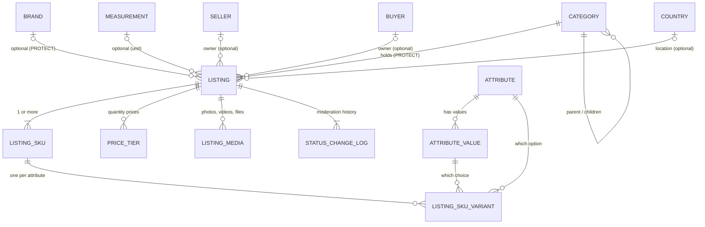
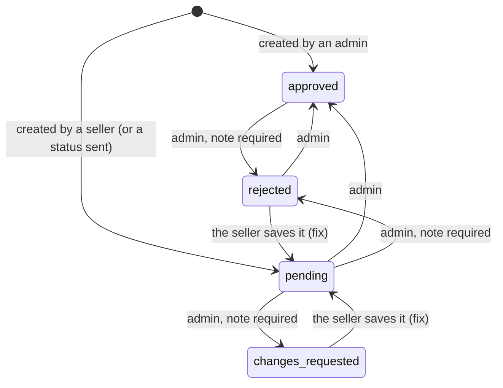

# Listing — the Complete Guide

Everything about listings in one place: what a listing is, what it is connected to
(categories, brands, attributes, SKUs, geography, owners), what you must create first,
how to create every kind of listing, and what happens to it afterwards (media, moderation, edits, delete).
It covers **both sides**: the admin (sections 1-12) and the **seller** who creates and manages their own listings (section 13).
A plain-language version for everyone, with no API details, is [`Egoola_Listing_Guide.md`](Egoola_Listing_Guide.md).

This guide explains the whole picture. For the exact request and response of one
topic, the other guides go deeper:

| Topic | Deeper guide |
|---|---|
| Listing endpoints, moderation tables, brand CRUD, the pending list | [listing-module-guide.md](listing-module-guide.md) |
| The seller's listing endpoints and lookups (request / response) | [seller-api-guide.md](seller-api-guide.md) section 6 |
| Attributes, attribute values, SKU rules | [attribute-sku-guide.md](attribute-sku-guide.md) |
| Category tree and parent chain | [category-tree-api-guide.md](category-tree-api-guide.md) |
| Country / state / city / thana | [geography-api-guide.md](geography-api-guide.md) |
| Login, tokens, errors, pagination | [frontend-api-guide.md](frontend-api-guide.md) |
| Postman | `postman/Egoola-Listing.postman_collection.json`, `postman/Egoola-Attribute.postman_collection.json` (admin); `postman/Egoola-SellerApp.postman_collection.json` → **Seller listings** (seller) |

Base URL: `http://127.0.0.1:8000/api/v1`. Sections 1-12 are the **admin** endpoints (`/catalog/...`): every call needs
`Authorization: Bearer <admin access token>`; seller and buyer tokens get `403`; no token gets `401`. The **seller** endpoints
(`/seller/listings/...`, section 13) need a seller token instead. The ids in the examples come from the demo
database, yours will differ — always load ids from the list APIs.

---

## 1. The big picture

One **listing** is one thing for sale or one request for work. The same table holds every format:
the six product formats (`general`, `used`, `village`, `retail`, `wholesale`, `brand`), services, and job
requests posted by buyers. (The old app had a separate table for each of them.)

A listing does not hold its own price or stock. They live on **SKUs** (sellable combinations).



In words:

- A listing belongs to **one category** (required).
- It may have **one brand**, **one measurement unit**, **one owner** (a seller or a buyer, or neither when an admin creates it) and a **location**.
- It has **one or more SKUs**. Each SKU has its own price, discount and stock, and (when the product has options) a set of
  **variants** such as "Size = M" and "Colour = Red".
- Variants are built from **attributes** (Size, Colour ...) and their **values** (S, M, L ... / Red, Blue ...).
- It may have **price tiers** (cheaper per unit for larger quantities), **media** (photos, videos, documents), and always has a
  **status history**.

### How the parts are connected, and what happens on delete

| From | To | Required? | If you try to delete the target |
|---|---|---|---|
| Listing → Category | `category` | **yes** | blocked, `409` (deactivate the category instead) |
| Listing → Brand | `brand` | only for `listing_type = brand` | blocked, `409` |
| Listing → Measurement | `measurement` | no | allowed; the listing's measurement becomes empty |
| Listing → Seller / Buyer | `seller` / `buyer` | no (never both) | deleting a seller or buyer **deletes their listings** |
| Listing → Country / State / City / Thana | location | no | allowed; the field becomes empty |
| SKU → Listing | `listing` | yes | deleting a listing (soft delete) keeps its SKUs |
| Variant → Attribute / Attribute value | `attribute`, `attribute_value` | yes | blocked, `409` while a SKU uses it (deactivate instead) |
| Attribute value → Attribute | `attribute` | yes | deleting an unused attribute also deletes its values |

### What is *not* connected

- **Attributes are not tied to categories.** Any active attribute can be used on any listing in any category.
  (If you later want "Size only for Fashion", that needs a category-to-attribute link; it does not exist yet.)
- **The measurement unit is not tied to SKUs.** It is one unit for the whole listing (for example `kg`, `pc`).
- **Price tiers are listing-wide** for now (they have an optional `listing_sku` reserved for later).

---

## 2. What to create first (in this order)

Think of it like filling the dropdowns of the "Create listing" screen. Everything on the left must exist before you use it.

| # | You need | Needed when | Where |
|---|---|---|---|
| 1 | **Category** | always | `/catalog/categories/` |
| 2 | **Measurement** (unit) | recommended for products | `/catalog/measurements/` |
| 3 | **Brand** | only for `listing_type = brand` (optional otherwise) | `/catalog/brands/` |
| 4 | **Attributes + values** | only when the product has options (sizes, colours, ...) | `/catalog/attributes/`, `/catalog/attribute-values/` |
| 5 | **Seller** or **Buyer** | only if the listing should have an owner | `/accounts/sellers/`, `/accounts/buyers/` |
| 6 | **Country / State / City / Thana** | only if the listing has a location | `/geography/...` |

### 2.1 Category

Categories are **one tree for both products and services**.

```
Electronics (product)
├── Mobiles
│   └── Smartphones          <- a listing can use any level
└── Laptops & Computers
Home Services (service)
├── Cleaning
└── Plumbing
```

Create one:
```json
POST /catalog/categories/
{ "type": "product", "name": "Smartphones", "parent": 19, "sort_order": 1, "status": "active" }
```
- `type` (`product` or `service`) and `name` are required. `parent`, `sort_order`, `status` (`active` default / `inactive`) and an `image` (file) are optional.
- The `slug` is made by the server from the name. The same name cannot appear twice **within the same type**.
- A parent must be the **same type** as its child, and a category cannot become its own ancestor (loops are rejected).
- The API has create, update, list (`?type=`, `?status=`, `?search=`) and delete. There is no single-category GET.
- Useful reads: `GET /catalog/categories/tree/?type=product` (the whole tree, not paginated) and
  `GET /catalog/categories/parent-chain/?categoryIds=38` (breadcrumb: `Electronics > Mobiles > Smartphones`).
- The table also has a Bangla name column (`nameBn`), but the category API does not accept it yet.

**Category rules for a listing**

1. The category's `type` must equal the listing's `catalog_type`. A service category cannot hold a product:
   `{"category": ["This is a service category; a product listing needs a product category."]}`
2. The category must be **active** when you choose it: `{"category": ["This category is inactive."]}`.
   (If it is deactivated *later*, the listing stays and can still be edited.)
3. Any level works: you can use a parent category or a leaf. Using the most specific one (a leaf) is best for browsing.
4. A category that listings use cannot be deleted. `DELETE` returns `409`
   `{"detail": "This category, or one of its sub-categories, is used by one or more listings. Deactivate it instead of deleting."}`.

### 2.2 Measurement

The unit of the product: `Piece (pc)`, `Kilogram (kg)`, `Litre (L)`, `Box (box)` ...
```json
POST /catalog/measurements/   { "name": "Kilogram", "symbol": "kg" }
```
Listing field: `measurement` (id). Optional. It is only a label for stock and price ("per kg"); it does not change any calculation.

### 2.3 Brand

A simple admin-managed list (`name`, `is_active`). Listings **pick** a brand from it, they never type one.
```json
POST /catalog/brands/   { "name": "Samsung" }
```
- A listing with `listing_type = "brand"` **must** have a `brand`. Any other type may have one.
- A newly chosen brand must be active (an already-attached brand that is deactivated later does not block edits).
- A brand used by any listing (even a soft-deleted one) cannot be deleted: `409`. Deactivate it.

### 2.4 Attributes and values

Only needed when one product comes in options (see section 5 for how they become SKUs).
```json
POST /catalog/attributes/         { "name": "Size", "name_bn": "সাইজ" }
POST /catalog/attribute-values/   { "attribute": 21, "name": "XL" }
```
- English name required, Bangla name optional, `is_active` defaults to true.
- A value belongs to one attribute and keeps it forever. The same value name is allowed under another attribute.
- Full field list and endpoints: [attribute-sku-guide.md](attribute-sku-guide.md).

### 2.5 Owner (seller or buyer)

| Listing kind | `posted_by_role` | Owner field |
|---|---|---|
| A seller's offer (product or service) | `seller_offer` | `seller` |
| A buyer's job request | `buyer_request` | `buyer` |
| Created by the admin, no owner | leave out | neither |

- Never both a `seller` and a `buyer`.
- `seller_offer` cannot have a `buyer`; `buyer_request` cannot have a `seller`.

### 2.6 Location

Optional: `country`, `state`, `city`, `thana` (ids). They must be **on one branch of the geography tree**: the state belongs to the country, the city to the state, the thana to the city.
Any level can be left out. Example: country 126 (Bangladesh), state 13 (Chittagong), city 8 (Feni). Using state 12 (Dhaka) with city 8 is rejected:
`{"city": ["This city does not belong to the selected state."]}`.

---

## 3. Product or service? Which fields apply

| | Product (`catalog_type = "product"`) | Service (`catalog_type = "service"`) |
|---|---|---|
| Category type | product | service |
| `listing_type` | `general` `used` `village` `retail` `wholesale` `brand` | usually left empty |
| Typical `posted_by_role` | `seller_offer` | `seller_offer` (offer) or `buyer_request` (job request) |
| Product-side fields | `brand`, `model`, `origin`, `warranty`, `measurement`, `min_order_qty`, `condition_note`, `attributes` (free-form specs) | — |
| Service-side fields | — | `price_type` (`fixed` / `hourly`), `hourly_rate`, `delivery_days`, `urgent`, `package_includes`, `available_from`, `available_to` |
| Options with their own price | Size, Colour, Storage ... (SKUs) | Package, Home size ... (SKUs) |

The meaning of the six product formats: `general` (normal shop item), `used` (second-hand: use `condition_note`),
`village` (local/village produce or handmade), `retail`, `wholesale` (bulk, use price tiers and `min_order_qty`), `brand` (a branded product: `brand` required).

`attributes` on a listing is a free-form JSON object for specs that are **not** options a buyer picks
(for example `{"ram": "6GB", "network": "4G"}`). Do not confuse it with **Attributes** (Size, Colour): those are real options and become SKUs.

---

## 4. Creating a listing — step by step

All of these are `POST /catalog/listings/`. A listing created by an admin is **approved** immediately unless you send a `status`.

### 4.1 The simplest listing (no options, no owner)

A product or service that has one price and no sizes/colours. Send `price`; the server makes one default SKU for you.

```json
{
  "category": 18,
  "catalog_type": "product",
  "title": "USB-C Charger 20W",
  "description": "Fast charger with cable.",
  "price": "900.00",
  "stock_qty": 40
}
```
Required: `category`, `catalog_type`, `title`, `description`, and either `price` or `skus`.

`price` here is a shortcut. It also accepts `discounted_price`, `discount_start_date`, `discount_end_date`, `stock_qty` and `sku` (a product code).
The response has `skus` with the one SKU, and the listing's own `price` / `discounted_price` repeat it.

### 4.2 A product with options (sizes, colours, storage ...)

1. Make sure the **attributes and values exist** (section 2.4).
2. Decide which attributes this product uses (say Size and Colour) and which values.
3. Send **one SKU per combination**, each with its own price, discount and stock.

```json
{
  "category": 22,
  "catalog_type": "product",
  "listing_type": "general",
  "posted_by_role": "seller_offer",
  "seller": 7,
  "title": "Men's Cotton Panjabi",
  "description": "Soft cotton with embroidery.",
  "measurement": 8,
  "country": 126, "state": 13, "city": 8,
  "skus": [
    { "sku": "PNJ-M-WHT", "price": "1800.00", "discounted_price": "1500.00", "stock_qty": 12,
      "variants": [ { "attribute": 21, "attribute_value": 33 }, { "attribute": 22, "attribute_value": 56 } ] },
    { "sku": "PNJ-L-WHT", "price": "1900.00", "stock_qty": 8,
      "variants": [ { "attribute": 21, "attribute_value": 34 }, { "attribute": 22, "attribute_value": 56 } ] }
  ]
}
```
(Attribute 21 = Size, 22 = Colour; value 33 = M, 34 = L, 56 = White.)

The rules for SKUs (full list in the attribute guide):
- Every SKU must use **the same attributes** (all Size + Colour — not one SKU with only Size).
- **No two SKUs** with the same combination.
- A variant's value must belong to its attribute, and a newly chosen attribute/value must be active.
- SKU codes (`sku`) are unique across the whole system.
- `skus` and the `price` shortcut cannot be sent together.

### 4.3 A branded product

```json
{
  "category": 38, "catalog_type": "product", "listing_type": "brand", "posted_by_role": "seller_offer", "seller": 7,
  "brand": 12, "model": "SM-A155F", "warranty": "1 year",
  "title": "Samsung Galaxy A15", "description": "6.5-inch AMOLED, 50MP camera.",
  "measurement": 8, "attributes": { "network": "4G" },
  "skus": [
    { "sku": "SAM-A15-128-BLK", "price": "24500.00", "discounted_price": "22900.00", "stock_qty": 25,
      "variants": [ { "attribute": 23, "attribute_value": 66 }, { "attribute": 22, "attribute_value": 55 } ] }
  ]
}
```
`brand` is mandatory when `listing_type` is `brand`: `{"brand": ["A brand listing must select a brand."]}`.

### 4.4 A wholesale product with quantity prices

Quantity prices are **tiers** and apply to the whole listing:
```json
"price_tiers": [
  { "min_qty": 10,  "max_qty": 49,   "price": "750.00", "discounted_price": "720.00" },
  { "min_qty": 50,  "max_qty": 199,  "price": "750.00", "discounted_price": "690.00" },
  { "min_qty": 200, "max_qty": null, "price": "750.00", "discounted_price": "650.00" }
]
```
- `min_qty` / `max_qty` at least 1, `max_qty` not below `min_qty`; `max_qty: null` means "and above".
- Tiers must not overlap, and only the last tier may be open-ended.
- Sending `price_tiers` **replaces the whole list**; sending `[]` clears it; leaving the key out on an update keeps the tiers.
- A tier may carry `listing_sku` (one of this listing's SKU ids) — optional, reserved for later.
- Add `min_order_qty` (at least 1) for wholesale.

### 4.5 A service

```json
{
  "category": 29, "catalog_type": "service", "posted_by_role": "seller_offer", "seller": 7,
  "title": "Home Deep Cleaning Service", "description": "Full-home clean by a team of 3.",
  "price_type": "fixed", "delivery_days": 1, "urgent": false,
  "package_includes": "Floor scrubbing, kitchen degreasing, bathroom sanitising",
  "skus": [
    { "sku": "CLEAN-800",  "price": "3000.00", "discounted_price": "2700.00",
      "variants": [ { "attribute": 25, "attribute_value": 80 } ] },
    { "sku": "CLEAN-1200", "price": "4500.00",
      "variants": [ { "attribute": 25, "attribute_value": 81 } ] }
  ]
}
```
- A service does not track stock: leave `stock_qty` out (it stays empty = "not tracked").
- Packages or sizes are modelled exactly like product options: an attribute ("Home Size") with values, and one SKU per value.
- For a single-price service just send `price`.

### 4.6 A buyer's job request

```json
{
  "category": 30, "catalog_type": "service", "posted_by_role": "buyer_request", "buyer": 4,
  "title": "Need a plumber for bathroom pipe repair", "description": "Leaking pipe under the basin.",
  "price_type": "hourly", "hourly_rate": "600.00", "price": "1500.00", "urgent": true, "delivery_days": 1
}
```
Here `price` is the buyer's budget (one default SKU). Do not send a `seller`.

### 4.7 With photos and files (multipart)

Images go in a **multipart/form-data** request. Multipart cannot carry the nested `skus` list, so choose one of these:

- **Simple listing:** one multipart `POST` with the flat fields (`price`, `stock_qty` ...) and `media_file` repeated once per file. Verified: the shortcut works in multipart.
- **Listing with options:** create it with JSON first, then add the files with a multipart `PATCH` containing only `media_file`.

```bash
curl -X PATCH http://127.0.0.1:8000/api/v1/catalog/listings/276/ \
  -H "Authorization: Bearer <token>" \
  -F "media_file=@front.jpg" -F "media_file=@box.jpg"
```
- `media_type` (`image` / `video` / `document`) is detected from each file. Files are saved under `media/listing/<listing id>/`
  and returned as `media: [{ id, media_type, media_path, media_url }]`.
- Remove files with `{"media_delete_ids": [4, 5]}`.

### 4.8 Choosing the status when you create

| You send | Result |
|---|---|
| nothing (admin) | `approved` |
| `"status": "pending"` | waits for moderation |
| `"status": "rejected"` or `"changes_requested"` | needs a `note` too |

A future seller self-service create will default to `pending`.

---

## 5. Prices, discounts, stock — how SKUs work

A **SKU** is one sellable combination. Price, discount and stock belong to it.

| SKU field | Meaning |
|---|---|
| `price` | the original price (required for a new SKU, not negative) |
| `discounted_price` | the price charged while the discount runs. Empty → equals `price` (never empty in the response). Never above `price` |
| `discount_start_date` / `discount_end_date` | when the discount runs. Empty = no limit on that side. End must be after start |
| `stock_qty` | units in stock. Empty = not tracked (services). `0` = out of stock |
| `reserved_qty` | read only, units held for open orders (the order flow fills it later) |
| `is_active` | `false` hides the SKU from buyers. SKUs are **never deleted** |
| `variants` | the options of this SKU (`[]` for a listing without options) |
| `effective_price`, `is_discount_active` | read only. What the buyer pays **right now** and whether the discount applies right now |

**Discount window.** Outside the window the buyer pays `price`, even though `discounted_price` is stored.
Example: price 1900, discounted 1500, window 1–31 Oct. On 15 Oct → `effective_price` 1500; on 5 Nov → 1900.
Dates need a `discounted_price` lower than `price`.

**The listing-level `price` and `discounted_price`** are read-only: the original and the current price of the **cheapest active SKU**
("from 1,500"). They are `null` when no SKU is active. Use them on list pages.

**Changing SKUs later** (`PATCH` with `skus`): an item with an `id` changes that SKU (only the fields you send); an item without an `id`
adds a SKU; SKUs you leave out are untouched. To retire a SKU send `{"id": 41, "is_active": false}`. A plain `price` or `stock_qty` on update is rejected:
`{"price": "Prices and stock are changed through `skus`."}`.

**What to do with a stock of "5 Blue / M, 0 Blue / L":** that is two SKUs with `stock_qty` 5 and 0. The storefront shows L as sold out.

---

## 6. The complete field reference

### 6.1 Listing fields (create and update)

| Field | Type | Required | Notes |
|---|---|---|---|
| `category` | id | **yes** | active, same type as `catalog_type` |
| `catalog_type` | `product` \| `service` | **yes** | |
| `title` | text | **yes** | the slug is made from it. Extra spaces are tidied. **Unique per seller** (see section 9) |
| `title_bn` | text | no | Bangla title |
| `description` | text | **yes** | |
| `description_bn` | text | no | Bangla description |
| `listing_type` | `general` `used` `village` `retail` `wholesale` `brand` | no | products; `brand` needs `brand` |
| `posted_by_role` | `seller_offer` \| `buyer_request` | no | must match the owner |
| `seller` / `buyer` | id | no | never both |
| `brand` | id | only for `brand` listings | active when newly chosen |
| `model`, `origin`, `warranty` | text | no | |
| `origin_bn`, `warranty_bn` | text | no | Bangla versions |
| `currency` | text | no | default `BDT` |
| `measurement` | id | no | |
| `min_order_qty` | integer ≥ 1 | no | |
| `condition_note` | text | no | for used products |
| `condition_note_bn` | text | no | Bangla version |
| `attributes` | JSON object | no | free-form specs, not options |
| `price_type` | `fixed` \| `hourly` | no | services |
| `hourly_rate` | decimal ≥ 0 | no | services |
| `delivery_days` | integer ≥ 0 | no | |
| `urgent` | true / false | no | |
| `package_includes` | text | no | services |
| `package_includes_bn` | text | no | Bangla version |
| `available_from`, `available_to` | date-time | no | services |
| `country`, `state`, `city`, `thana` | ids | no | one branch of the tree |
| `status` | see section 8 | no | default `approved` (admin). A listing a **seller** creates is always `pending` |
| `note` | text | when rejecting / asking changes | only read with a status change |
| `skus` | list | **yes on create** (or `price`) | section 5 |
| `price`, `discounted_price`, `discount_start_date`, `discount_end_date`, `stock_qty`, `sku` | — | create only | shortcut for one default SKU |
| `price_tiers` | list | no | whole-list replace |
| `media_file` | files (multipart) | no | |
| `media_delete_ids` | list of ids | no | |

### 6.2 What comes back

`id`, `seller`, `buyer`, `category`, `catalog_type`, `listing_type`, `posted_by_role`, `title`, `title_bn`, `slug`, `description`, `description_bn`, `brand`, `brand_name`,
`model`, `origin`, `origin_bn`, `warranty`, `warranty_bn`, `price`, `discounted_price` (read only, cheapest active SKU), `currency`, `skus`, `price_type`, `hourly_rate`,
`delivery_days`, `urgent`, `package_includes`, `package_includes_bn`, `available_from`, `available_to`, `min_order_qty`, `measurement`, `condition_note`, `condition_note_bn`, `attributes`,
`country`, `state`, `city`, `thana`, `status`, `note`, `requested_at`, `price_tiers`, `media`, `status_change_logs`, `info_change_logs`, `created_at`, `updated_at`.
`requested_at` is read only: when the listing joined the pending list (section 8). `info_change_logs` is the content change history (section 9).

One SKU in the response:
```json
{
  "id": 106, "sku": "SAM-A15-128-BLK",
  "price": "24500.00", "discounted_price": "22900.00",
  "discount_start_date": "2026-10-06T15:28:16+06:00", "discount_end_date": "2026-10-31T15:28:16+06:00",
  "effective_price": "22900.00", "is_discount_active": true,
  "stock_qty": 25, "reserved_qty": 0, "is_active": true,
  "variants": [
    { "attribute": 22, "attribute_name": "Colour",  "attribute_value": 55, "attribute_value_name": "Black" },
    { "attribute": 23, "attribute_name": "Storage", "attribute_value": 66, "attribute_value_name": "128GB" }
  ]
}
```

---

## 7. Reading listings

| Call | Notes |
|---|---|
| `GET /catalog/listings/` | light rows: `id, title, title_bn, slug, catalog_type, listing_type, category, brand, seller, buyer, price, discounted_price, status, requested_at, created_at` |
| `GET /catalog/listings/{id}/` | full detail with SKUs, variants, tiers, media, **status history** and **info change history** |
| `GET /catalog/listings/requests/` | the **pending list**: listings waiting for a decision (section 8) |

List filters: `?status=`, `?catalog_type=`, `?listing_type=`, `?category=`, `?brand=`, `?seller=`, `?buyer=`,
`?created_from=` / `?created_to=` and `?requested_from=` / `?requested_to=` (dates, `YYYY-MM-DD`, inclusive),
`?search=` (title, Bangla title, brand name, model, SKU code), `?limit=`, `?offset=` (default 20, max 100).
A soft-deleted or unknown listing is `404`.

For a breadcrumb on the detail page, call `GET /catalog/categories/parent-chain/?categoryIds=<category id>`.

---

## 8. After creation: moderation

Every listing has a **status**:


(An admin can move a listing between any statuses with a `PATCH`; the arrows show the normal flow. An **approved** listing a seller edits
**stays approved**: sellers never send an approved listing back to review.)

| Status | Meaning |
|---|---|
| `draft` | not submitted yet |
| `pending` | waiting for an admin |
| `approved` | visible to buyers |
| `rejected` | refused — a note explains why |
| `changes_requested` | sent back for edits — a note says what to change |

Rules (the same as for seller verification):
- `rejected` and `changes_requested` need a **note**: `{"note": ["A note is required when rejecting a listing or requesting changes."]}`.
- The **note belongs to the status change.** It is read only when the status really changes; any other `note` is ignored.
  `note` on the listing always equals the note of the **latest** change, and is cleared (`null`) when you change status without one.
- Every status change adds a row to `status_change_logs` (newest first): the status, the note, who did it (`created_by`, `creator_type`, `creator_name`) and when. Creating a listing writes the first row.
- Re-sending the status the listing already has is not a change: no history row, no note needed.
- **`requested_at`** is when the listing joined the pending list. It is set when a seller creates a listing, and again every time a
  `rejected` or `changes_requested` listing goes back to `pending` (the seller saving it, or an admin setting `pending`). Admin-created
  approved listings have `requested_at: null`.

### The pending list (admin)

`GET /catalog/listings/requests/` lists only `status = pending`, **newest request first**, with **cursor pagination** (follow `next` /
`previous` exactly as given; there is no `count`). It takes the list filters (`seller`, `catalog_type`, `listing_type`, `category`, `brand`,
`created_*`, `requested_*`, `search`) and `ordering` (`requested_at`, `created_at`, `title`, `id`; `-` reverses). A resubmitted listing shows
up at the top again. For a menu badge use `GET /catalog/listings/?status=pending&limit=1` and read `count`.

Moderate one: `PATCH /catalog/listings/{id}/` with `{"status": "rejected", "note": "Photos are low quality"}`.

Moderate many: `POST /catalog/listings/bulk-moderate/`
```json
{ "listing_ids": [31, 32, 33], "status": "approved", "note": null }
```
Only `approved`, `rejected`, `changes_requested` are allowed here. The answer lists `updated` and `skipped` (already in that status) in the order you sent them. It is all-or-nothing.

---

## 9. Editing and deleting

`PATCH /catalog/listings/{id}/` changes only what you send. A quick summary:

| Goal | Send |
|---|---|
| Edit text, brand, category, location ... | the field(s) |
| Change a price / discount / stock | `skus` with the SKU `id` |
| Add a size/colour combination | `skus` item without `id`, with `variants` |
| Hide a combination | `skus` item `{"id": .., "is_active": false}` |
| Replace quantity prices | `price_tiers` (whole list) |
| Add photos | multipart `media_file` |
| Remove photos | `media_delete_ids` |
| Change status | `status` (+ `note`) |

If you change `title`, the `slug` is regenerated. **A seller cannot have two live listings with the same title** (upper / lower case and extra
spaces do not matter): the API answers `400` `{"title": ["This seller already has a listing with this title. Update that listing instead. (listing #123)"]}`
(for a seller using their own endpoint the message starts with "You already have a listing..."). It applies to admin-created listings that name a
seller too, and when an admin moves a listing to a seller who already has that title. Listings with no seller and buyer requests are not affected,
and a **deleted** listing frees its title.
 Changing `catalog_type` or `category` is checked against each other again (type match, active category).
Every update stamps `updated_by` / `updated_at`.

**Info change log.** Every save that really changes a listing's content adds one row to `info_change_logs` (newest first), by the seller or by an
admin: `changed_fields`, `previous_data` and `new_data` (same keys, only what changed), and who / when (`created_by`, `creator_type`, `creator_name`,
`created_at`). Tracked: all text and Bangla fields, category, brand, measurement, owner, location, service details, `attributes`, and three groups
shown as whole lists before and after: `price_tiers`, `skus` (price, discount, discount dates, `is_active`, options; **not** stock) and `media`.
Places and brand show as `{"id": .., "name": ..}`. Status changes are not here (see `status_change_logs`). Saving the same values writes nothing.


**Delete** (`DELETE /catalog/listings/{id}/`) is a **soft delete**: `204`, and the listing disappears from every list and detail call, but the row, its SKUs and its history stay. Its slug and SKU codes stay reserved.
There is no restore endpoint yet.

---

## 10. Common errors

| What went wrong | Response |
|---|---|
| no `skus` and no `price` | `400` `{"skus": ["A listing needs at least one SKU: send `skus`, or `price` for a single default SKU."]}` |
| `skus` and `price` together | `400` `{"skus": "Send either `skus` or the price shortcut, not both."}` |
| `price` / `stock_qty` on an update | `400` `{"price": "Prices and stock are changed through `skus`."}` |
| category of the wrong type | `400` `{"category": ["This is a service category; a product listing needs a product category."]}` |
| inactive category / brand | `400` `{"category": ["This category is inactive."]}` / `{"brand": ["This brand is inactive."]}` |
| `listing_type: brand` without `brand` | `400` `{"brand": ["A brand listing must select a brand."]}` |
| both `seller` and `buyer` | `400` `{"buyer": ["A listing cannot have both a seller and a buyer."]}` |
| owner does not match `posted_by_role` | `400` on `buyer` / `seller` |
| city not in the chosen state | `400` `{"city": ["This city does not belong to the selected state."]}` |
| negative price / stock | `400` on the field |
| discount above price | `400` `{"skus": {"0": {"discounted_price": "Cannot be higher than price (price is the original price)."}}}` |
| two SKUs with one combination | `400` `{"skus": ["Every SKU of a listing needs its own combination of options (two SKUs have the same one)."]}` |
| SKUs using different attributes | `400` `{"skus": ["All SKUs of a listing must use the same attributes (e.g. all Size + Colour)."]}` |
| SKU code already used | `400` `{"skus": {"0": {"sku": "A SKU with this code already exists."}}}` |
| overlapping price tiers | `400` `{"price_tiers": ["Price tier quantity ranges must not overlap, and only the last tier can have no max_qty."]}` |
| the seller already has a listing with that title | `400` `{"title": ["This seller already has a listing with this title. Update that listing instead. (listing #123)"]}` |
| reject without a note | `400` `{"note": ["A note is required when rejecting a listing or requesting changes."]}` |
| delete a used category / brand / attribute / value | `409` with a message to deactivate it instead |
| seller or buyer token | `403` · no token `401` |

---

## 11. A checklist for the admin "Create listing" screen

1. **Kind:** product or service → sets `catalog_type`. Then choose `listing_type` (products) and `posted_by_role`.
2. **Category:** show the tree (`/categories/tree/?type=<kind>`), only active ones, and send the chosen id.
3. **Brand** (required for `brand`), **measurement**, **model / origin / warranty** (products), or **price type / delivery / package** (services).
4. **Owner:** a seller (offer) or a buyer (request), or none.
5. **Location:** cascading dropdowns (country → state → city → thana), each filtered by the one above.
6. **Options?** If yes, pick attributes and values (`/attributes/?is_active=true`, values come with each attribute), generate every combination as a row with
   `sku` code, `price`, `discounted_price`, discount dates, `stock_qty`, and send them as `skus`. If no, show one price box and send `price` (+ stock).
7. **Quantity prices** (wholesale): a small table → `price_tiers`.
8. **Media:** upload after the listing exists (multipart `PATCH`), or in the same multipart request for a simple listing.
9. **Status:** leave the default, or choose `pending`.
10. On the **edit** screen, load `GET /listings/{id}/`, send back only what changed, with SKU ids.

---

## 12. Quick answers

- *Do I create a product per size/colour?* No. One listing, one SKU per combination.
- *Where is the price?* On the SKUs. The listing shows the cheapest active one as "from".
- *Can I delete a SKU?* No, hide it with `is_active: false`.
- *Can I use any attribute in any category?* Yes. Attributes are not tied to categories.
- *Is the category required?* Yes, and it must match the listing type and be active.
- *Do services use SKUs?* Yes. Every listing has at least one SKU; a plain service has one.
- *Where does the order flow come in?* Cart items and order items already have a `listingSkuId`; the order APIs are not built yet.
- *What if I delete a listing?* It is hidden (soft delete); everything is kept.

---

## 13. Sellers: creating and managing their own listings

A seller who is **verified and active** manages their own listings through one shared set of endpoints, for every kind of listing
(`general`, `used`, `village`, `retail`, `wholesale`, `brand`, and services). Full request and response examples are in
[seller-api-guide.md](seller-api-guide.md) section 6; the rules are:

| Call | What it does |
|---|---|
| `POST /seller/listings/` | create a listing. It is **always `pending`**, owned by the seller, `posted_by_role = seller_offer` |
| `GET /seller/listings/` | my listings, with filters (below) |
| `GET /seller/listings/{id}/` | one of my listings: full detail, SKUs, tiers, media, **status history** (not the info change log) |
| `PATCH` / `PUT /seller/listings/{id}/` | edit it |
| `GET /seller/lookups/categories/`, `/brands/`, `/measurements/`, `/attributes/` | read-only lists to fill the form (only active ones) |
| `DELETE` | **not allowed** (`405`). Only an admin can delete a listing |

Use a seller token. A seller who is still waiting for approval, was rejected, or is paused gets `403` with a message that says which.
A seller never sees another seller's listing (`404`), an admin-owned listing, or a buyer request.

**What a seller can send.** The same fields as the admin (section 6.1) except `seller`, `buyer`, `posted_by_role`, `status` and `requested_at`:
they are not accepted (sending them changes nothing). The seller can attach media, price tiers and SKUs exactly like an admin.

**What happens when a seller edits:**

| Listing is | A seller's save (PATCH or PUT, even an empty one) does |
|---|---|
| `pending` | stays `pending`; `requested_at` unchanged |
| `approved` | stays `approved`, **whatever changes** (content, SKUs, prices, stock). The edit is written to the info change log for the admin |
| `rejected` or `changes_requested` | goes back to **`pending`**, `requested_at` = now (top of the admin's pending list). There is no separate Resubmit button: saving is resubmitting |

For a rejected listing the seller reads the admin's reason in `note`. A `note` sent when saving a rejected / changes-requested listing becomes the
seller's message to the reviewer (an empty or missing note clears it); in any other state a `note` is ignored. The admin's reason is kept in
`status_change_logs`, which the seller can read.

**Same title.** A seller cannot create a second listing with a title they already have. If an earlier listing with that title was **rejected**,
the seller must update that listing instead (the error names it: "listing #123"). Nobody can create a duplicate by deleting, because sellers
cannot delete.

**My list filters:** `?status=`, `?catalog_type=`, `?listing_type=`, `?category=`, `?brand=`, `?created_from=` / `?created_to=`,
`?requested_from=` / `?requested_to=`, `?search=` (title, Bangla title, SKU code, brand name), `?ordering=` (`created_at`, `updated_at`, `requested_at`,
`title`, `status`, `id`; `-` reverses; default newest first), `?limit=` / `?offset=`. Rows: `id, title, title_bn, slug, catalog_type, listing_type,
category, brand, price, discounted_price, status, note, requested_at, created_at, updated_at`.

**Checklist for the seller "Create listing" screen:** same as section 11, except: no owner and no status choice (it is always mine and pending); fill the
dropdowns from `/seller/lookups/...` (categories filtered by `type`, brands, measurements, attributes with their values) and the public geography lists;
show the Bangla fields next to the English ones; after saving, show the status ("Waiting for review"); on a rejected listing show the reason and let the seller
edit and save.

**Admin's view of seller listings.** Nothing new to call: a seller's listing is an ordinary listing with `seller` set and `posted_by_role = seller_offer`.
New ones arrive in the pending list; approve or reject with `PATCH` or `bulk-moderate`; read the seller's changes in `info_change_logs`.

---

## 14. Tests

- `scripts/smoke/sku_smoke.py` (attributes, SKUs, category protection), `listing_smoke.sh`, `brand_smoke.sh`, `e2e_smoke.sh`: all pass. Run everything with `scripts/smoke/run_all.sh`.
- `seller_listing_smoke.sh`: the seller listing API, lookups, unique title, the pending list, approve / reject / fix, the info change log, Bangla fields and files removed from storage.
- Postman: `Egoola-Listing` and `Egoola-Attribute` (admin) and `Egoola-SellerApp` → **Seller listings** (seller) collections pass in Newman.
