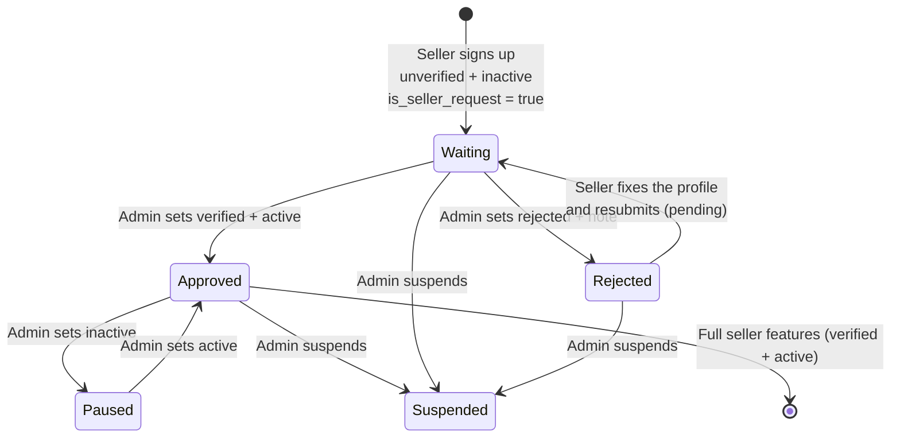

# Seller API Guide — the seller-facing APIs

This is the **only** guide for the APIs built **for sellers** (the seller sign-up form, the seller panel and the
seller app). It covers: public location lookups, sign-up with KYC documents, seller login, the seller's own profile
(`/seller/me`), resubmit after a rejection, change password, **the seller's products** (section 6) and **the seller's gigs** (section 6b), each
with its own thumbnail endpoint (section 6.8).

- **Plain-language guides** (no API details): `Egoola_Seller_Guide.md` (the seller process) and `Egoola_Listing_Guide.md` (listings).
- **Postman:** `postman/Egoola-SellerApp.postman_collection.json` (one collection for all of it) and
  `postman/Egoola-Local.postman_environment.json`.
- **Smoke tests:** `scripts/smoke/seller_self_smoke.sh`, `seller_listing_smoke.sh`, `public_geography_smoke.sh`, and the sign-up part of
  `seller_onboarding_smoke.sh`.
- **Not in this guide: the admin side** (seller list, filters, Seller Request queue, approve / reject, profile change
  history). That is in [`seller-verification-guide.md`](seller-verification-guide.md) and
  [`frontend-api-guide.md`](frontend-api-guide.md) §8, with the collection `Egoola-Seller.postman_collection.json`.
- Every example below is a real response from the running server.

---

## 1. The big picture

### A seller's life



### Two switches, not one

A seller has two separate fields. Do not mix them up:

| Field | Values | Meaning |
|---|---|---|
| `verification_status` | `unverified`, `pending`, `verified`, `rejected` | The **KYC decision**. A seller is **approved** when this is `verified`. |
| `status` | `active`, `inactive`, `suspended` | The **account switch**. `inactive` = the seller cannot do anything except edit their profile, for the time being, until an admin sets `active`. It is used for a brand-new sign-up **and** for an approved seller an admin has paused. `suspended` = blocked completely. |

`can_operate` = `verified` **and** `active`. Only a seller who can operate may use the full seller features
(listings, orders, wallet...). Every other seller is limited to their own profile.

### What each state can do

| Seller state | Can log in? | Can edit own profile? | Full seller features? |
|---|---|---|---|
| Just signed up: `unverified` + `inactive` | yes | yes | **no** |
| `pending` (resubmitted) + `inactive` | yes | yes | **no** |
| `rejected` + `inactive` | yes | yes (to fix and resubmit) | **no** |
| `verified` + `active` (**can operate**) | yes | yes (identity documents locked) | **yes** |
| `verified` + `inactive` (approved but **paused** by an admin) | yes | yes (identity documents locked) | **no**, until an admin makes them `active` |
| `suspended` (any `verification_status`) | **no** (`401`) | no | no |

The server loads the seller fresh on every request, so an approval, a pause or a suspension works immediately, not
when the token expires. Every future seller feature (listings, orders, wallet...) is built behind a "can operate"
check, so a seller who cannot operate gets `403` there, with a message that says why (section 6).

### The seller-facing endpoints

| Who | Endpoint | What |
|---|---|---|
| Anyone | `GET /api/v1/public/geography/{countries,states,cities,thanas}/` | Location dropdowns (section 2) |
| Anyone | `POST /api/v1/auth/seller/register/` | Sign up with documents (section 3) |
| Seller | `POST /api/v1/auth/seller/login/` | Log in (section 4) |
| Seller | `GET`, `PATCH /api/v1/seller/me/` | Own profile (section 5) |
| Seller | `POST /api/v1/seller/me/resubmit/` | Resubmit after a rejection (section 5.4) |
| Seller | `POST /api/v1/seller/me/change-password/` | Change own password (section 5.5) |
| Seller (can operate) | `POST`, `GET /api/v1/seller/listings/` | Create a product, list my products (section 6) |
| Seller (can operate) | `GET`, `PATCH`, `PUT /api/v1/seller/listings/{id}/` | See and edit one of my products (section 6) |
| Seller (can operate) | `PUT`, `DELETE /api/v1/seller/listings/{id}/thumbnail/` | Set, replace or remove the cover picture (section 6.8) |
| Seller (can operate) | `POST`, `GET /api/v1/seller/gigs/` | Create a gig, list my gigs (section 6b) |
| Seller (can operate) | `GET`, `PATCH`, `PUT /api/v1/seller/gigs/{id}/` | See and edit one of my gigs (section 6b) |
| Seller (can operate) | `PUT`, `DELETE /api/v1/seller/gigs/{id}/thumbnail/` | Set, replace or remove the gig's cover picture (section 6.8) |
| Seller (can operate) | `GET /api/v1/seller/lookups/{categories,brands,measurements,attributes}/` | Lists for the listing form (section 6.1) |

What an admin does with these sellers (review the documents, approve, reject) is in the admin guide. Where this guide
says "an admin approves", the admin does it with `PATCH /accounts/sellers/{id}/`
(`{"verification_status": "verified", "status": "active"}`).

---

## 2. Public lookups for the sign-up form (no login)

The sign-up form runs before anyone is logged in, so its dropdowns cannot use the
admin geography API (that one needs an admin token). Use these instead. They are
**public, read-only** (`GET` only), and need **no token**. Even a stale or expired
token in the browser is ignored, so these never return `401`.

| Dropdown | Endpoint | Filters |
|---|---|---|
| Country | `GET /api/v1/public/geography/countries/` | `search` |
| State | `GET /api/v1/public/geography/states/` | `country`, `search` |
| City | `GET /api/v1/public/geography/cities/` | `country`, `state`, `search` |
| Thana (optional) | `GET /api/v1/public/geography/thanas/` | `country`, `state`, `city`, `search` |

Load the dropdowns one level at a time: when the seller picks a country, call
`states/?country=<id>`; when they pick a state, call `cities/?state=<id>`; when they
pick a city, call `thanas/?city=<id>`. An empty list is normal (the thana list is
empty for most cities). Send the chosen `id`s in the form.

```json
GET /api/v1/public/geography/countries/
{ "count": 3, "next": null, "previous": null,
  "results": [ { "id": 126, "name": "Bangladesh", "slug": "bangladesh", "country_code": "645", "flag_url": null } ] }

GET /api/v1/public/geography/states/?country=126
{ "count": 2, "next": null, "previous": null,
  "results": [ { "id": 13, "name": "Chittagong", "slug": "chittagong", "country": 126 },
               { "id": 12, "name": "Dhaka", "slug": "dhaka", "country": 126 } ] }

GET /api/v1/public/geography/cities/?state=13
{ "count": 2, "next": null, "previous": null,
  "results": [ { "id": 8, "name": "Feni", "slug": "feni", "country": 126, "state": 13 },
               { "id": 9, "name": "Noakhali", "slug": "noakhali", "country": 126, "state": 13 } ] }
```

- Each list is wrapped like the other lists (`count`, `next`, `previous`, `results`) and
  sorted by name. `limit` defaults to **500** (max 1000), so a dropdown gets the whole
  list. You normally never need `offset`.
- Rows have only `id`, `name`, `slug` and the parent ids (countries also have
  `country_code` and `flag_url`). The audit columns the admin API shows are not public.
- `POST`, `PATCH` and `DELETE` do not work here (`405` / `404`).
- `business_type`, `employees_range` and `annual_revenue` (business profile) are free
  text: the frontend decides which choices to offer.

---

## 3. Seller sign-up (public)

**`POST /api/v1/auth/seller/register/`**

- No token needed. Send **`multipart/form-data`** (it carries files; a plain JSON
  request cannot carry the NID). A token sent by mistake is ignored.

### Fields

| Field | Required | Notes |
|---|---|---|
| `name` | yes | |
| `email` | yes | Must be new. Upper and lower case count as the same email. (Not used to log in.) |
| `phone` | yes | Must be new. **This is the number the seller logs in with.** |
| `password` | yes | At least 8 characters, not a very common password, not all digits. |
| `present_address` | yes | Text. |
| `permanent_address` | yes | Text. |
| `country`, `state`, `city` | yes | Ids from the public lookups (section 2). The state must belong to the country, the city to the state. |
| `thana` | no | Id. If sent, it must belong to the city. |
| `media_for` + `media_file` | yes | The documents (below). |
| `profile_pic` | no | One image file. |
| `info` | no | The business profile, as a JSON **string** (below). |

### Documents (`media_for` + `media_file`)

Send them as pairs. The 1st `media_for` goes with the 1st `media_file`, the 2nd with
the 2nd, and so on. Both lists must be the same length.

- `media_for` can be `nid`, `birth_certificate`, `certificate` or `other`.
- **At least one `nid` is required.** A seller with a front and back scan sends two `nid` pairs.
- Each file must be **JPG, PNG, WEBP or PDF**, and **5 MB or smaller**.
- At most **10** files in one request.

```
media_for:   nid
media_file:  <front.jpg>
media_for:   nid
media_file:  <back.jpg>
media_for:   certificate
media_file:  <trade-licence.pdf>
```

### Business profile (`info`, optional)

A JSON string in the form. If you send it, six fields are required: `business_type`,
`main_product`, `owner_name`, `employees_range`, `annual_revenue`, `established_year`.
Optional: `description`, `public_email`, `whatsapp`, `facebook`, `wechat`, `skype`, and
`country`, `state`, `city`, `thana` (same location rule). A half-filled `info` is a `400`.
The seller can also add it later with `PATCH /seller/me/` (section 5).

```json
{
  "business_type": "Retail",
  "main_product": "Shoes",
  "owner_name": "Rafiq Ahmed",
  "employees_range": "1-10",
  "annual_revenue": "< $50,000",
  "established_year": "2020"
}
```

### Example (browser code)

```js
const form = new FormData();
form.append("name", "Rafiq Ahmed");
form.append("email", "rafiq@example.com");
form.append("phone", "+8801711000111");
form.append("password", "Sell@12345");
form.append("present_address", "House 12, Road 5, Feni Sadar");
form.append("permanent_address", "Village Pashchim Para, Feni");
form.append("country", 126);
form.append("state", 13);
form.append("city", 8);
form.append("media_for", "nid");
form.append("media_file", nidFrontFile);
form.append("media_for", "nid");
form.append("media_file", nidBackFile);

// Do NOT set the Content-Type header yourself. The browser adds it, with the boundary.
const response = await fetch(`${API}/auth/seller/register/`, { method: "POST", body: form });
```

### Success — `201`

```json
{
  "id": 121,
  "name": "Rafiq Ahmed",
  "email": "rafiq@example.com",
  "phone": "+8801711000111",
  "present_address": "House 12, Road 5, Feni Sadar",
  "permanent_address": "Village Pashchim Para, Feni",
  "country": 126,
  "state": 13,
  "city": 8,
  "thana": null,
  "verification_status": "unverified",
  "status": "inactive",
  "is_seller_request": true,
  "message": "Registration received. An admin will review your documents. You can log in now to complete your profile; you can start selling once your account is approved and active."
}
```

There is **no token** in the response. The seller can log in right away (section 4) to complete their profile,
so send them to the login page, or to a "thank you, we will review it" screen with a login button.
`verification_status`, `status` and `is_seller_request` cannot be chosen by the client;
if a form sends them, they are ignored.

### Errors — `400`

Same shape as every endpoint: `{ "field": ["message", ...] }`.

| Problem | Error key | Message |
|---|---|---|
| A required field is missing | the field name | `This field is required.` |
| Email already used | `email` | `seller with this email already exists.` (same text if only the case differs) |
| Phone already used | `phone` | `seller with this phone already exists.` |
| Weak password | `password` | `This password is too short...` (a list) |
| State not in the country, city not in the state | `state` / `city` / `thana` | `This city does not belong to the selected state.` |
| No `media_for` / `media_file` at all | `media_for`, `media_file` | `This field is required.` |
| Different number of `media_for` and `media_file` | `media_for` | `Provide exactly one media_for value for each media_file, in the same order.` |
| No `nid` among the documents | `media_for` | `At least one NID document is required (media_for = nid).` |
| Wrong file type | `media_file` | `note.txt: only JPG, PNG, WEBP or PDF files are accepted.` |
| File over 5 MB | `media_file` | `big.png: each file must be 5 MB or smaller.` |
| More than 10 files | `media_file` | `Upload at most 10 documents.` |
| Profile picture is not a real image | `profile_pic` | |
| Incomplete business profile | `info` | the missing business fields |

A failed sign-up saves nothing: no seller row and no half-uploaded files are left behind.
A seller who was **rejected** cannot sign up again with the same phone or email (they are
taken). They log in, fix their details and use **resubmit** (section 5.4).

---

## 4. Login

**`POST /api/v1/auth/seller/login/`** with `{ "phone", "password" }`.

**A seller logs in with their phone number and password, not their email.** (Admins and buyers still use email.) The
phone number is exactly the one given at sign-up (the server ignores spaces around it). Sending `email` instead of `phone`
is `400 {"phone": ["This field is required."]}`. Because the phone number is the login, an admin who changes a seller's
phone number changes how that seller logs in: the old number stops working at once.

A seller who **cannot operate yet** (still waiting, rejected, or approved but paused) can log in. The response tells
the app which screens to show:

```json
{
  "access": "eyJhbGciOiJIUzI1NiIs...",
  "refresh": "eyJhbGciOiJIUzI1NiIs...",
  "actor_type": "seller",
  "id": 211,
  "name": "Rafiq Ahmed",
  "email": "smoke.guide@example.com",
  "phone": "+8801700096001",
  "verification_status": "unverified",
  "status": "inactive",
  "can_operate": false
}
```

What to do in the app:

- `can_operate: true` → the normal seller app.
- `can_operate: false` → profile screens only (profile form, documents, change password). Choose the message from the two switches:
  - `verification_status` is `unverified` or `pending` → "Your application is under review."
  - `verification_status` is `rejected` → show the reason (`GET /seller/me/` → `verification_note`) and a **Resubmit** button.
  - `verification_status` is `verified` and `status` is `inactive` → "Your account is paused. An admin has to make it active again."
- A **suspended** seller gets `401 {"detail": "This account is not active."}`.
- A wrong password **or an unknown phone number** is `401 {"detail": "Invalid phone number or password."}` (the same message
  for both, so nobody can find out which numbers are registered).

Tokens, refresh and error shapes are the same as everywhere else: see
`frontend-api-guide.md` §3–4 and `authentication.md`.

---

## 5. The seller's own profile — `/api/v1/seller/me/`

Open to any logged-in seller who is not suspended (whether or not they can operate). Send `Authorization: Bearer <access>`.
An admin or buyer token gets `403`.

### 5.1 Read — `GET /api/v1/seller/me/`

```json
{
  "id": 211,
  "name": "Rafiq Ahmed Khan",
  "email": "smoke.guide@example.com",
  "phone": "+8801700096001",
  "profile_pic_url": null,
  "present_address": "Shop 4, Trunk Road, Feni",
  "permanent_address": "Village Pashchim Para, Feni",
  "country": 126, "state": 13, "city": 8, "thana": null,
  "skills": null, "education": null, "experience": null, "interest": null,
  "media": [
    { "id": 176, "media_type": "image", "media_for": "nid",
      "media_path": "seller/nid/26a72124a475432c956f6fcd55d766aa.png",
      "media_url": "/media/seller/nid/26a72124a475432c956f6fcd55d766aa.png" }
  ],
  "business_info": {
    "business_type": "Retail", "main_product": "Bags", "owner_name": "Rafiq Ahmed",
    "employees_range": "1-10", "annual_revenue": "< $50,000", "established_year": "2020",
    "description": null, "public_email": null, "whatsapp": null, "facebook": null,
    "wechat": null, "skype": null, "country": null, "state": null, "city": null, "thana": null
  },
  "verification_status": "unverified",
  "verification_note": null,
  "status": "inactive",
  "is_seller_request": true,
  "can_operate": false,
  "created_at": "2026-10-11T22:38:52.250133+06:00",
  "requested_at": "2026-10-11T22:38:51.947603+06:00"
}
```

- `verification_note` is the admin's reason when the seller was rejected. Show it.
- No password, wallet or change log is returned here.
- `media_url` is a path on a local server (`/media/...`): put the server address in front.
  In production it is a full, short-lived signed URL.

### 5.2 Edit — `PATCH /api/v1/seller/me/`

Send only the fields that change. Use JSON for text fields and **multipart/form-data**
when a file is included.

| Field | Editable? | Notes |
|---|---|---|
| `name` | yes | Not blank. |
| `profile_pic` | yes | One image (file). |
| `present_address`, `permanent_address` | yes | Not blank. |
| `country`, `state`, `city`, `thana` | yes | Must match each other (same rule as sign-up). `country`/`state`/`city` cannot be null. |
| `skills`, `education`, `experience`, `interest` | yes | Free JSON (lists). |
| `info` | yes | The business profile. Send the whole object; six fields required (section 3). Read back as `business_info`. |
| `media_for` + `media_file`, `media_delete_ids` | yes | Documents (5.3). |
| `email`, `phone` | **no, for now** | The same value is accepted; a different one is `400`: `{"email": ["Email cannot be changed."]}`. |
| `verification_status`, `verification_note`, `status`, `is_seller_request`, `can_operate`, `created_at`, `requested_at` | **never** | Read-only. Sending them changes nothing: a seller cannot approve themselves. |

Returns `200` with the same body as `GET /seller/me/`.

Every real change is written to a **profile change log** that admins read on the seller detail (the seller does
not see it). Sending the same values again writes nothing.

### 5.3 Documents

Same pairs as sign-up: `media_for` (`nid`, `birth_certificate`, `certificate`, `other`) and
`media_file` (JPG / PNG / WEBP / PDF, 5 MB each, 10 per request). To remove a document,
send its `id` (from `media`) in `media_delete_ids`. To replace one, delete the old one
and upload the new one **in the same request**.

**Who can change which document, and when**

| Seller's verification | NID, birth certificate | Certificates and "other" documents |
|---|---|---|
| `unverified`, `pending` or `rejected` (not approved yet) | **Can add, delete and replace** (at least one NID must always remain) | Can add, delete and replace |
| `verified` (approved), active **or** inactive | **Locked.** Only an admin can change them | Can add, delete and replace |

The first row is on purpose: a **rejected** seller has to be able to fix a blurry or wrong NID before they resubmit. The
second row protects the identity check that was already done. An admin is never blocked by the lock.

Rules:

- **At least one NID must always remain.** Deleting the only NID without uploading a new
  one in the same request is `400`: `At least one NID document is required. Upload the new NID in the same request.`
- **After verification, identity documents are locked.** A verified seller cannot add or
  delete `nid` or `birth_certificate` documents: `400 {"media_for": ["Your identity documents (NID, birth certificate) are locked after verification. Ask an admin to change them."]}`.
  Other documents (`certificate`, `other`) and every other field stay editable.
- A seller can only touch their own documents. An id that belongs to someone else is ignored.
- **Deleted files are really deleted.** When a document is deleted (or replaced), or a profile photo is replaced, the
  old file is removed from storage as soon as the change is saved. A refused request (for example, deleting the only
  NID) keeps the file.
- Errors for file type, size and count are the same as at sign-up.

```
PATCH /api/v1/seller/me/        (multipart/form-data)
media_delete_ids:  176
media_for:         nid
media_file:        <new-nid.jpg>
```

### 5.4 Resubmit after a rejection — `POST /api/v1/seller/me/resubmit/`

A rejected seller logs in, reads the reason (`verification_note`), fixes their details and
documents with `PATCH /seller/me/`, then resubmits. Body (optional): `{ "note": "..." }`,
at most 1000 characters: a message to the reviewer.

What happens:

- `verification_status` becomes **`pending`**, `is_seller_request` becomes `true` and
  `requested_at` becomes now, so the seller is back in the admin's Seller Request queue,
  as the **newest** request (admin side: `seller-verification-guide.md`).
- The seller's `note` becomes `verification_note` (the note on the row always belongs to
  the current status). The admin's rejection reason stays in `verification_logs`.
- A history entry is added, made by the seller (`creator_type: "seller"`).
- `status` stays `inactive`. An admin still has to approve with `verified` + `active`.

Only a **rejected** seller can resubmit; anyone else gets
`400 {"detail": "Only a rejected application can be resubmitted."}` (this includes a
seller who is already `pending`). The response is the same body as `GET /seller/me/`.

### 5.5 Change password — `POST /api/v1/seller/me/change-password/`

```json
{ "current_password": "Sell@12345", "new_password": "Better@2468" }
```

- `200 {"detail": "Password changed."}`. The current token keeps working.
- `400` for a wrong `current_password` (`Incorrect password.`), a weak or reused
  `new_password` (it must follow the password rules and differ from the current one).
- The change is logged for admins, but the password itself is never stored in the log.

---

## 6. Listings: create and manage my products

One shared set of endpoints for **every product format** (`general`, `used`, `village`, `retail`, `wholesale`, `brand`). A seller's
**services are gigs**: they are on `/seller/gigs/` (section 6b), and a service sent here is `400`. Admin-side rules, SKUs and the full field
reference are in [`listing-complete-guide.md`](listing-complete-guide.md); the plain-language version is `Egoola_Listing_Guide.md`.

**Who can use it.** Only a seller who **can operate** (verified **and** active). Everyone else gets `403` with a message that says why:

- not approved yet: `{"detail": "Your seller application is not approved yet. You can only edit your profile until an admin approves it."}`
- approved but inactive: `{"detail": "Your seller account is inactive. You can only edit your profile until an admin makes it active."}`

A seller sees and changes **only their own, non-deleted products**. Another seller's listing, an admin-owned listing, a buyer request and the
seller's own gigs are `404` here. **A seller cannot delete a listing** (`DELETE` is `405`).

### 6.1 Lookups for the form (read-only)

All need the same seller token. They return **only active** items and are paged like the geography lists (`limit` default 500, max 1000).

| Endpoint | Rows | Filters |
|---|---|---|
| `GET /api/v1/seller/lookups/categories/` | `id, type, parent, name, name_bn, slug, sort_order` | `type` (`product` \| `service`), `parent`, `search` |
| `GET /api/v1/seller/lookups/brands/` | `id, name, slug` | `search` |
| `GET /api/v1/seller/lookups/measurements/` | `id, name, slug, symbol` | `search` |
| `GET /api/v1/seller/lookups/attributes/` | `id, name, name_bn, values[{id, name, name_bn}]` | `search` |

```json
GET /api/v1/seller/lookups/categories/?type=product&limit=2
{ "count": 11, "next": ".../categories/?limit=2&offset=2&type=product", "previous": null,
  "results": [ { "id": 18, "type": "product", "parent": null, "name": "Electronics", "name_bn": "", "slug": "electronics", "sort_order": 1 },
               { "id": 25, "type": "product", "parent": 24, "name": "Furniture", "name_bn": "", "slug": "furniture", "sort_order": 1 } ] }

GET /api/v1/seller/lookups/attributes/        (an attribute with its active values)
{ "id": 22, "name": "Colour", "name_bn": "রং", "values": [ { "id": 55, "name": "Black", "name_bn": "কালো" }, { "id": 56, "name": "White", "name_bn": "সাদা" } ] }
```

Locations come from the public geography lists (section 2). A category must match the listing's `catalog_type` and be active.

### 6.2 Create: `POST /api/v1/seller/listings/`

JSON, or `multipart/form-data` when files are included. The new listing is **always `pending`**, owned by the logged-in seller, `posted_by_role = seller_offer`.
**Not accepted** (ignored if sent): `seller`, `buyer`, `posted_by_role`, `status`, `requested_at`, and `note` on create.

Required: `category`, `catalog_type`, `title`, `description`, and either `skus` or a `price` (a shortcut for one default SKU).
Everything else is optional. The fields are the same as the admin's (see `listing-complete-guide.md` section 6.1):

| Group | Fields |
|---|---|
| Basics | `category`, `catalog_type` (optional: it is always `product` here; `service` is `400`), `listing_type`, `title`, `description` |
| Bangla (all optional) | `title_bn`, `description_bn`, `condition_note_bn`, `warranty_bn`, `origin_bn` |
| Product | `brand` (needed for `listing_type: brand`), `model`, `origin`, `warranty`, `measurement`, `min_order_qty`, `condition_note`, `attributes` (JSON specs) |
| Place | `country`, `state`, `city`, `thana` (must match each other) |
| Price and stock | `skus` (list: `sku`, `price`, `discounted_price`, discount dates, `stock_qty`, `is_active`, `variants`), **or** the create shortcut `price`, `discounted_price`, `discount_start_date`, `discount_end_date`, `stock_qty`, `sku` |
| Quantity prices | `price_tiers` (list of `min_qty`, `max_qty`, `price`, `discounted_price`) |
| Files | `media_file` (multipart, see 6.7) |

```json
POST /api/v1/seller/listings/
{ "category": 18, "catalog_type": "product", "listing_type": "general",
  "title": "Cotton T-Shirt", "title_bn": "সুতির টি-শার্ট",
  "description": "Soft cotton t-shirt.", "description_bn": "নরম সুতির টি-শার্ট।",
  "origin": "Bangladesh", "origin_bn": "বাংলাদেশ",
  "price": "500", "discounted_price": "450", "stock_qty": 20, "sku": "TEE-CAP-001" }
```

`201`:

```json
{ "id": 681, "category": 18, "catalog_type": "product", "listing_type": "general",
  "title": "Cotton T-Shirt", "title_bn": "সুতির টি-শার্ট", "slug": "cotton-t-shirt",
  "description": "Soft cotton t-shirt.", "description_bn": "নরম সুতির টি-শার্ট।",
  "origin": "Bangladesh", "origin_bn": "বাংলাদেশ", "currency": "BDT",
  "price": "500.00", "discounted_price": "450.00",
  "skus": [ { "id": 593, "sku": "TEE-CAP-001", "price": "500.00", "discounted_price": "450.00", "effective_price": "450.00",
              "is_discount_active": true, "stock_qty": 20, "reserved_qty": 0, "is_active": true, "variants": [] } ],
  "status": "pending", "note": null, "requested_at": "2026-10-12T09:41:03.595364+06:00",
  "price_tiers": [], "media": [],
  "status_change_logs": [ { "id": 1119, "status": "pending", "note": null, "creator_type": "seller", "created_at": "2026-10-12T09:41:03.599409+06:00" } ],
  "created_at": "2026-10-12T09:41:03.596790+06:00", "updated_at": "2026-10-12T09:41:03.596790+06:00",
  "...": "plus the other fields, null when empty" }
```

The seller's response has **no** `seller`, `buyer`, `posted_by_role` or `info_change_logs`. `price` / `discounted_price` are read-only: the cheapest active SKU.
Options (sizes, colours...) are sent as `skus` with `variants` (`attribute` + `attribute_value` ids from the attributes lookup); one SKU per combination.

### 6.3 Same title rule

A seller **cannot have two listings with the same title** (upper / lower case and extra spaces do not matter). If they try, they must update the existing one:

```json
400 { "title": ["You already have a listing with this title. Update the existing listing instead. (listing #681)"] }
```

This is true even when the earlier listing was **rejected**: the seller updates that listing (6.5). Sellers cannot delete, so they cannot get around it.
Another seller may use the same title. An admin deleting a listing frees its title.

### 6.4 List and detail

`GET /api/v1/seller/listings/`: limit / offset pagination (`count`, `next`, `previous`, `results`; default 20, max 100), newest first.

| Param | Example | Meaning |
|---|---|---|
| `status` | `=rejected` | `pending`, `approved`, `rejected`, `changes_requested`, `draft` |
| `listing_type` | `=used` | the six product formats |
| `category`, `brand` | `category=18` | ids |
| `created_from`, `created_to` | `=2026-10-01` | creation date, inclusive, `YYYY-MM-DD` |
| `requested_from`, `requested_to` | `=2026-10-01` | the date it joined the pending list (creation, or the last time it went back to pending) |
| `search` | `=cotton` | title, Bangla title, SKU code, brand name |
| `ordering` | `=title` | `created_at`, `updated_at`, `requested_at`, `title`, `status`, `id`; `-` reverses |
| `limit`, `offset` | `limit=20` | paging |

```json
{ "count": 1, "next": null, "previous": null,
  "results": [ { "id": 681, "title": "Cotton T-Shirt", "title_bn": "সুতির টি-শার্ট", "slug": "cotton-t-shirt",
                 "catalog_type": "product", "listing_type": "general", "category": 18, "brand": null,
                 "price": "500.00", "discounted_price": "450.00", "status": "pending", "note": null,
                 "requested_at": "2026-10-12T09:41:03.595364+06:00",
                 "created_at": "2026-10-12T09:41:03.596790+06:00", "updated_at": "2026-10-12T09:41:03.596790+06:00" } ] }
```

`GET /api/v1/seller/listings/{id}/` is the full listing (same shape as the create response): SKUs with options, price tiers, media and the **status history**.
The status history shows `status`, `note`, `creator_type` (`seller` or `admin`) and `created_at`, but **not which admin**. The seller does **not** get the info change log.

### 6.5 Edit: `PATCH` or `PUT /api/v1/seller/listings/{id}/`

Send only what changes (`PATCH`). The same fields as create, except the price shortcut: change prices and stock through `skus` with the SKU `id`
(`{"skus": [{"id": 593, "price": "550", "stock_qty": 99}]}`); a SKU is hidden with `"is_active": false`, never deleted. `price_tiers`, when sent, replaces the whole list.

**What the save does to the status:**

| The listing is | A seller's save (even an empty `{}`) does |
|---|---|
| `pending` | stays `pending`; `requested_at` unchanged |
| `approved` | stays `approved`, **whatever changes** (content, SKUs, prices, stock). The admin can see the change in the info change log |
| `rejected`, `changes_requested` (or an admin-made `draft`) | goes back to **`pending`**, `requested_at` = now. **There is no Resubmit button: saving is resubmitting** |

`status` can never be changed by a seller. For a rejected listing, `note` is the admin's reason. A `note` sent when saving a rejected / changes-requested listing becomes the
**seller's message to the reviewer** (no note clears it); in any other state a `note` is ignored. The admin's reason is kept in `status_change_logs`.

```json
GET /api/v1/seller/listings/681/        (after an admin rejected it)
{ "id": 681, "status": "rejected", "note": "Please add a clear photo.", "requested_at": "2026-10-12T09:41:03.595364+06:00",
  "status_change_logs": [ { "id": 1120, "status": "rejected", "note": "Please add a clear photo.", "creator_type": "admin",  "created_at": "2026-10-12T09:41:03.925444+06:00" },
                          { "id": 1119, "status": "pending",  "note": null,                        "creator_type": "seller", "created_at": "2026-10-12T09:41:03.599409+06:00" } ] }

PATCH /api/v1/seller/listings/681/
{ "description": "Soft cotton t-shirt, now with size chart.", "note": "Added a size chart." }
200 { "id": 681, "status": "pending", "note": "Added a size chart.", "requested_at": "2026-10-12T09:41:04.174396+06:00",
      "status_change_logs": [ { "id": 1121, "status": "pending", "note": "Added a size chart.", "creator_type": "seller", "created_at": "..." },
                              { "id": 1120, "status": "rejected", "note": "Please add a clear photo.", "creator_type": "admin", "created_at": "..." },
                              { "id": 1119, "status": "pending", "note": null, "creator_type": "seller", "created_at": "..." } ] }
```

On the admin side the resubmitted listing is back at the top of the pending list (`requested_at` = now). Every real change is written to the admin-only info change log
(before and after; stock changes are not recorded).

### 6.6 Files

Send `media_file` as repeated parts in a `multipart/form-data` create or edit. Allowed: **JPG, PNG, WEBP, GIF, MP4, PDF**; **10 MB** each; at most **10 per request** and
**20 per listing**. To remove files send `media_delete_ids` (ids from `media`); the file is deleted from storage straight away. A seller can only remove their own listing's files.

### 6.7 Errors

| What went wrong | Response |
|---|---|
| no token / admin or buyer token | `401` / `403` |
| `catalog_type: "service"`, or a service-only field (`delivery_days`, `urgent`, `package_includes`, ...), or a gig SKU field (`price_type`, `description`) | `400` (services are gigs: `/seller/gigs/`) |
| a gig id on this endpoint | `404` |
| seller cannot operate (pending, rejected, paused) | `403` with the message in the intro of this section |
| another seller's listing, or an admin's | `404` |
| `DELETE` | `405` |
| same title as one of mine | `400` `{"title": ["You already have a listing with this title. Update the existing listing instead. (listing #681)"]}` |
| no `skus` and no `price` | `400` `{"skus": ["A listing needs at least one SKU: send `skus`, or `price` for a single default SKU."]}` |
| `price` or `stock_qty` on an edit | `400` `{"price": "Prices and stock are changed through `skus`."}` |
| category of the wrong type or inactive | `400` `{"category": [...]}` |
| `listing_type: brand` without `brand`; an inactive brand | `400` `{"brand": [...]}` |
| inactive attribute value in `variants` | `400` on `skus` |
| negative price; discount above price | `400` on the field |
| the same SKU code twice, or one another listing uses | `400` `{"skus": ...}` |
| overlapping price tiers | `400` `{"price_tiers": [...]}` |
| city not in the state | `400` `{"city": ["This city does not belong to the selected state."]}` |
| a file of the wrong type, over 10 MB, or too many | `400` `{"media_file": [...]}` |

### 6.8 The thumbnail (products and gigs)

The cover picture has its own endpoints (it is not part of create or edit): `PUT` / `DELETE /seller/listings/{id}/thumbnail/` and
`PUT` / `DELETE /seller/gigs/{id}/thumbnail/`. `PUT` is `multipart/form-data` with one field `image` (JPG, PNG or WEBP, up to 10 MB) and returns
`{"image_path", "image_url", "status"}`; `DELETE` is `204`. The old file is deleted from storage. `image_path` / `image_url` are read only and come
back on the list rows and the detail. It counts as an edit: it is written in the admin's info change log, and on a `rejected` / `changes_requested`
product or gig it sends it back to `pending` (like saving it); on an approved or pending one the status stays. Only a seller who can operate, only on
their own listing (`404` otherwise). Details and errors: [`listing-complete-guide.md`](listing-complete-guide.md) section 15.

---

## 6b. Gigs: create and manage my gigs

A **gig** is a service the seller offers (cleaning, photography, repair). It is created, listed, seen and edited on **`/seller/gigs/`**, with the
same access rules, moderation and "saving is resubmitting" behaviour as products, but a different price model: **packages**. Every package is a SKU with a
`price_type` (`hourly`, `daily`, `weekly`, `monthly` or `fixed`), and a `price` (the rate for that unit). A package has **no duration**: the buyer chooses how many hours, days, weeks or months when ordering and pays the rate
times that number. A gig has **no options, no stock, no brand and no quantity prices**, at most **one package per price
type**, and no delete for the seller. The complete guide (every rule, error, filter and response) is **[`listing-complete-guide.md`](listing-complete-guide.md) section 14**; the plain-language
version is `Egoola_Listing_Guide.md` section 12. In short:

| Call | What it does |
|---|---|
| `POST /seller/gigs/` | create: always `pending`, owned by me (`seller`, `buyer`, `posted_by_role`, `status` are ignored). `catalog_type` is not needed |
| `GET /seller/gigs/` | my gigs. Filters: `status`, `category`, `price_type`, `created_*`, `requested_*`, `search`, `ordering`, `limit`, `offset` |
| `GET /seller/gigs/{id}/` | one gig with its packages and the status history (a product id is `404`) |
| `PATCH` / `PUT /seller/gigs/{id}/` | edit. Rejected / changes-requested goes back to `pending`; approved stays approved |
| `PUT` / `DELETE /seller/gigs/{id}/thumbnail/` | the cover picture (section 6.8) |
| `DELETE /seller/gigs/{id}/` | not allowed (`405`) |

```json
POST /api/v1/seller/gigs/
{ "category": 29, "title": "Logo Design", "description": "A logo in 3 days.", "delivery_days": 3,
  "skus": [ { "price": "1500", "price_type": "fixed", "description": "One logo, two revisions" },
            { "price": "400", "price_type": "hourly" } ] }
```

`201`: `"status": "pending"`, two packages (a fixed 1500 and an hourly 400), and a status history with the seller's creation entry. For a single package you can
send `price` and `price_type` on the gig itself. Lookups: `GET /seller/lookups/categories/?type=service` and the public geography lists.

---

## 7. What a seller who cannot operate can NOT do

Everything outside `/seller/me/...`. Products (section 6) and gigs (section 6b) need a seller who **can operate** (verified **and** active), and so will orders, wallet and
withdrawals when they are built. Everyone else gets `403` with a message that says which switch is holding them back:

- not verified yet (unverified, pending, rejected):
  `{"detail": "Your seller application is not approved yet. You can only edit your profile until an admin approves it."}`
- verified but `inactive`:
  `{"detail": "Your seller account is inactive. You can only edit your profile until an admin makes it active."}`

Admin endpoints (`/accounts/...`) are always `403` for a seller, whatever their state.

---

## 8. Rules in one place

| Rule | |
|---|---|
| Sign-up always creates `unverified`, `inactive`, `is_seller_request = true`, `requested_at` = now | server |
| The client cannot choose status, verification or the flag | read-only fields |
| Sign-up needs at least one NID; JPG/PNG/WEBP/PDF, 5 MB, 10 files | server |
| Email unique ignoring case; phone unique | server |
| Country / state / city / thana must match each other | server (everywhere) |
| Password: 8+ characters, not common, not all digits | server |
| Sellers who cannot operate (pending, rejected, or approved but inactive) can log in but only use `/seller/me/...`; full features need verified AND active | `IsSellerActor` / `IsActiveVerifiedSellerActor` |
| Suspended sellers cannot log in and their token stops working | login + every request |
| A seller logs in with **phone number + password** (not email); an admin changing the phone changes the login | login |
| Email and phone cannot be changed by the seller (for now) | `/seller/me/` |
| Identity documents (NID, birth certificate) locked once `verified`; at least one NID always | `/seller/me/` |
| Products and gigs: only a seller who can operate; always my own; new = `pending`; a save (or a thumbnail change) on a rejected / changes-requested one = `pending` again; an approved one stays approved; no delete; one title per seller per kind; products and gigs are separate endpoints (the other kind is `404`) | `/seller/listings/`, `/seller/gigs/` |
| A gig is priced by packages: one SKU per `price_type` (the rate; the buyer chooses the duration when ordering); no options, stock or quantity prices | `/seller/gigs/` |
| Only a `rejected` seller can resubmit; result is `pending` + back in the queue | `/seller/me/resubmit/` |
| Every real profile change is logged (before and after) for admins | change log |

---

## 9. Not built yet

Do not build screens against these:

- **Email / phone verification (OTP).** The columns exist but there is no endpoint;
  `email_verified` and `phone_verified` are `false` for everyone.
- **Changing email or phone** (the seller cannot, for now).
- **Notifications** (email or push) when a seller is approved, rejected or resubmits.
- **Rate limiting** on the public sign-up endpoint: put a limit in front of it before launch.
- **Per-document verification** (accept the NID, ask for a new certificate): verification is
  one decision for the whole seller.
- **Seeing the change history as a seller:** only admins see it, on the seller detail.
- **Deleting or hiding a listing as a seller**, saving a seller draft, bulk upload, and any message to the seller when a listing is approved or rejected.
- **The other seller features** (for sellers who can operate): hire requests on a gig (accept, decline, deliver), the job board and bidding,
  orders, the wallet and withdrawals: the next Phase 3 steps. Products, gigs and their thumbnails are built.

---

## 10. Try it

1. Start the server: `uv run manage.py runserver 8000`.
2. Import `postman/Egoola-SellerApp.postman_collection.json` and `postman/Egoola-Local.postman_environment.json`.
3. Run the folders in order: Setup (admin token), Public lookups, Seller sign-up, Seller — own profile, After approval, **Seller listings**, After review.
   Requests named **[Admin step]** are not seller APIs: they play the admin so you can see what a seller sees after an
   approval, a rejection and a suspension. In every request with a file row, choose a real JPG, PNG or PDF in Postman.

Or from a terminal: `scripts/smoke/seller_self_smoke.sh`, `seller_onboarding_smoke.sh`, `public_geography_smoke.sh`.
