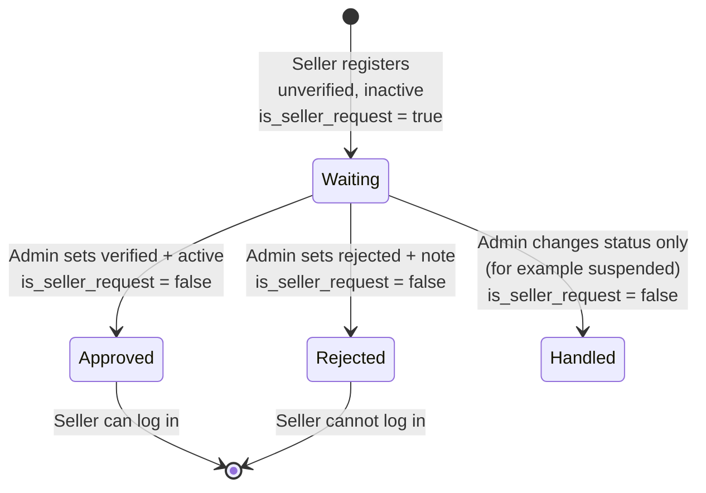

# Seller Onboarding, KYC and the Seller Request Queue

This guide covers two things:

1. **A seller signs up by themselves** and uploads their identity documents
   (public endpoint, no login), using public read-only lookups for the location dropdowns.
2. **The admin reviews those sign-ups** in a "Seller Request" list, then
   approves or rejects each one.

Everything below was run against the real server. The example responses are
real, not made up.

- Postman: `postman/Egoola-SellerOnboarding.postman_collection.json`
- Smoke tests: `scripts/smoke/seller_onboarding_smoke.sh` (161 checks), `scripts/smoke/public_geography_smoke.sh` (45 checks)
- Approving and rejecting uses the Seller API. The rules for the note and the
  history are in [`seller-verification-guide.md`](seller-verification-guide.md).

---

## 1. The whole flow in one picture



In words:

1. The seller fills in the sign-up form and uploads at least one NID file.
2. The account is created as **unverified** and **inactive**. The seller cannot
   log in yet. The account is flagged `is_seller_request = true`, so it shows up
   in the admin's **Seller Request** list.
3. An admin opens the request, looks at the documents, and approves or rejects.
4. The first time an admin changes the seller's `verification_status` or
   `status`, the flag turns `false` and the seller leaves the Seller Request list.

---

## 2. Public lookups for the sign-up form (no login)

The sign-up form runs before anyone is logged in, so its dropdowns cannot use the
admin geography API (that one needs an admin token). Use these instead. They are
**public, read-only** (`GET` only), and need **no token**. Even a stale or expired
token in the browser is ignored, so these never return `401`.

| Dropdown | Endpoint | Filters |
|---|---|---|
| Country | `GET /api/v1/public/geography/countries/` | `search` |
| State | `GET /api/v1/public/geography/states/` | `country`, `search` |
| City | `GET /api/v1/public/geography/cities/` | `country`, `state`, `search` |
| Thana (optional) | `GET /api/v1/public/geography/thanas/` | `country`, `state`, `city`, `search` |

Load the dropdowns one level at a time: when the seller picks a country, call
`states/?country=<id>`; when they pick a state, call `cities/?state=<id>`; when they
pick a city, call `thanas/?city=<id>`. An empty list is normal (the thana list is
empty for most cities). Send the chosen `id`s in the sign-up form.

Real responses:

```json
GET /api/v1/public/geography/countries/
{ "count": 3, "next": null, "previous": null,
  "results": [ { "id": 126, "name": "Bangladesh", "slug": "bangladesh", "country_code": "645", "flag_url": null } ] }

GET /api/v1/public/geography/states/?country=126
{ "count": 2, "next": null, "previous": null,
  "results": [ { "id": 13, "name": "Chittagong", "slug": "chittagong", "country": 126 },
               { "id": 12, "name": "Dhaka", "slug": "dhaka", "country": 126 } ] }

GET /api/v1/public/geography/cities/?state=13
{ "count": 2, "next": null, "previous": null,
  "results": [ { "id": 8, "name": "Feni", "slug": "feni", "country": 126, "state": 13 },
               { "id": 9, "name": "Noakhali", "slug": "noakhali", "country": 126, "state": 13 } ] }
```

Notes:

- Each list is wrapped like the other lists (`count`, `next`, `previous`, `results`) and
  sorted by name. A dropdown needs the whole list, so `limit` defaults to **500**
  (max 1000). You normally never need `offset`.
- Rows have only what a dropdown needs: `id`, `name`, `slug` and the parent ids
  (countries also have `country_code` and `flag_url`). The audit columns the admin
  API shows (who created or edited a row) are **not** public.
- `POST`, `PATCH` and `DELETE` do not work here (`405` / `404`). Changing geography
  stays on the admin API.
- The other sign-up fields need no lookup: `business_type`, `employees_range` and
  `annual_revenue` are free text, so the frontend decides the choices to offer.

---

## 3. Seller sign-up (public)

**`POST /api/v1/auth/seller/register/`**

- No token needed. The request is sent as **`multipart/form-data`**, because it
  carries files. (A plain JSON request cannot carry the NID, so it is rejected.)
- Even if a token is sent by mistake, it is ignored.

### Fields

| Field | Required | Notes |
|---|---|---|
| `name` | yes | |
| `email` | yes | Must be new. Upper and lower case count as the same email. |
| `phone` | yes | Must be new. |
| `password` | yes | At least 8 characters, not a very common password, not all digits. |
| `present_address` | yes | Text. |
| `permanent_address` | yes | Text. |
| `country`, `state`, `city` | yes | Ids from the public lookups (section 2). The state must belong to the country, and the city to the state. |
| `thana` | no | Id. If sent, it must belong to the city. |
| `media_for` + `media_file` | yes | The documents. See below. |
| `profile_pic` | no | One image file. |
| `info` | no | The business profile, as a JSON **string**. See below. |

### Documents (`media_for` + `media_file`)

Send them as pairs. The 1st `media_for` goes with the 1st `media_file`, the 2nd
with the 2nd, and so on. Both lists must be the same length.

- `media_for` can be `nid`, `birth_certificate`, `certificate` or `other`.
- **At least one `nid` is required.** A seller with a front and back scan sends
  two `nid` pairs.
- Each file must be **JPG, PNG, WEBP or PDF**, and **5 MB or smaller**.
- At most **10** files in one request.

```
media_for:   nid
media_file:  <front.jpg>
media_for:   nid
media_file:  <back.jpg>
media_for:   certificate
media_file:  <trade-licence.pdf>
```

### Business profile (`info`, optional)

Send it as a JSON string in the form. If you send it, these six fields are
required: `business_type`, `main_product`, `owner_name`, `employees_range`,
`annual_revenue`, `established_year`. The rest are optional: `description`,
`public_email`, `whatsapp`, `facebook`, `wechat`, `skype`, and `country`,
`state`, `city`, `thana` (they follow the same location rule).

```json
{
  "business_type": "Retail",
  "main_product": "Shoes",
  "owner_name": "Rafiq Ahmed",
  "employees_range": "1-10",
  "annual_revenue": "< $50,000",
  "established_year": "2020"
}
```

A half-filled `info` is an error. It is better to leave `info` out and let the
seller complete the profile later (the profile API comes in the next step of
Phase 3).

### Example (browser code)

```js
const form = new FormData();
form.append("name", "Rafiq Ahmed");
form.append("email", "rafiq@example.com");
form.append("phone", "+8801711000111");
form.append("password", "Sell@12345");
form.append("present_address", "House 12, Road 5, Feni Sadar");
form.append("permanent_address", "Village Pashchim Para, Feni");
form.append("country", 126);
form.append("state", 13);
form.append("city", 8);
form.append("media_for", "nid");
form.append("media_file", nidFrontFile);
form.append("media_for", "nid");
form.append("media_file", nidBackFile);

// Do NOT set the Content-Type header yourself. The browser adds it, with the boundary.
const response = await fetch(`${API}/auth/seller/register/`, { method: "POST", body: form });
```

### Success — `201`

```json
{
  "id": 121,
  "name": "Rafiq Ahmed",
  "email": "rafiq@example.com",
  "phone": "+8801711000111",
  "present_address": "House 12, Road 5, Feni Sadar",
  "permanent_address": "Village Pashchim Para, Feni",
  "country": 126,
  "state": 13,
  "city": 8,
  "thana": null,
  "verification_status": "unverified",
  "status": "inactive",
  "is_seller_request": true,
  "message": "Registration received. An admin will review your documents; you can log in once your account is approved."
}
```

There is **no token** in the response. Show the `message` to the seller and send
them to a "thank you, we will review it" screen.

`verification_status`, `status` and `is_seller_request` cannot be chosen by the
client. If a form sends them, they are ignored.

### Errors — `400`

The shape is the same as every other endpoint: `{ "field": ["message", ...] }`.

| Problem | Error key | Message |
|---|---|---|
| A required field is missing | the field name | `This field is required.` |
| Email already used | `email` | `seller with this email already exists.` (the same text if only the upper/lower case differs) |
| Phone already used | `phone` | `seller with this phone already exists.` |
| Weak password | `password` | `This password is too short...` (a list) |
| State not in the country, city not in the state | `state` / `city` / `thana` | `This city does not belong to the selected state.` |
| No `media_for` / `media_file` at all | `media_for`, `media_file` | `This field is required.` |
| Different number of `media_for` and `media_file` | `media_for` | `Provide exactly one media_for value for each media_file, in the same order.` |
| No `nid` among the documents | `media_for` | `At least one NID document is required (media_for = nid).` |
| Wrong file type | `media_file` | `note.txt: only JPG, PNG, WEBP or PDF files are accepted.` |
| File over 5 MB | `media_file` | `big.png: each file must be 5 MB or smaller.` |
| More than 10 files | `media_file` | `Upload at most 10 documents.` |
| Profile picture is not a real image | `profile_pic` | |
| Incomplete business profile | `info` | the missing business fields |

A failed sign-up saves nothing. No seller row and no half-uploaded profile are
left behind.

---

## 4. What happens when a pending seller tries to log in

`POST /api/v1/auth/seller/login/` with the right password returns **`401`**:

```json
{ "detail": "Your registration is under review. You can log in once an admin approves it." }
```

Show this message to the seller. After an admin has acted on the account, a
seller who is still inactive (for example, rejected) gets the plain message
`This account is not active.` A wrong password is always
`Invalid email or password.`

> Login failures are `401` (the same as the rest of the API). They used to be
> `403`; that was a bug and it is fixed.

---

## 5. Admin: the Seller Request list

**`GET /api/v1/accounts/sellers/requests/`** — Admin only (any admin, not just a
super-admin). A seller token or buyer token gets `403`.

It lists only sellers that registered themselves and have not been acted on yet
(`is_seller_request = true`).

### Cursor pagination (not limit/offset)

This list uses **cursor pagination**. The reason: this is a queue that changes
while the admin works. With offset paging, a new sign-up arriving between two
page loads shifts every row down and the admin sees a row twice or misses one.
A cursor never does that.

```json
{
  "next": "http://127.0.0.1:8000/api/v1/accounts/sellers/requests/?cursor=cD0yMDI2LTEwLTExKzE1JTNBMzQlM0E0OS4zMTk4ODglMkIwMCUzQTAw&limit=1&search=Smoke+Reg+Doc",
  "previous": null,
  "results": [
    {
      "id": 126,
      "name": "Smoke Reg Doc 2",
      "email": "smoke.reg.doc2@example.com",
      "phone": "+880170009552",
      "profile_pic_url": "/media/profile-pics/seller/53d92159fd8c456092600b4950c1fbc5.png",
      "verification_status": "unverified",
      "status": "inactive",
      "is_seller_request": true,
      "wallet_balance": "0.00",
      "bonus_balance": "0.00",
      "last_logged_at": null,
      "created_at": "2026-10-11T21:34:49.319888+06:00"
    }
  ]
}
```

(That response was requested with `limit=1`, so `next` points at the second row.)

How to use it:

- There is **no `count`** and no page numbers. There are only `next` and `previous`.
- `next` and `previous` are full URLs. **Use them exactly as given.** The
  `cursor` inside is opaque; do not try to read it or build it yourself.
- `next` is `null` on the last page. `previous` is `null` on the first page.
- `limit` sets the page size. Default 20, maximum 100.
- Build an "infinite scroll" or "Load more" list by following `next`.
- A broken or edited `cursor` returns `404`.

**Showing a number on the menu ("Seller Request (7)")?** The queue itself has no
count. Ask the normal list for it instead, with the same flag:
`GET /api/v1/accounts/sellers/?is_seller_request=true&limit=1` and read `count`.

### Sorting — `ordering`

| Value | Order |
|---|---|
| (nothing) | Newest request first |
| `created_at` | Oldest first (first come, first served) |
| `-created_at` | Newest first |
| `name` / `-name` | A to Z / Z to A |
| `id` / `-id` | By id |

Any other value is ignored and the default order is used.

### Filters

All filters combine (AND). They also work together with `search`, `ordering`
and `limit`.

| Param | Example | Meaning |
|---|---|---|
| `search` | `search=rafiq` | Partial match on name, email or phone |
| `verification_status` | `=unverified` | Exact. Or several: `verification_status__in=unverified,pending` |
| `status` | `=inactive` | Exact. Or several: `status__in=inactive,suspended` |
| `creator_type` | `=seller` | Who created the account: `seller` (self-registered) or `admin` |
| `country`, `state`, `city`, `thana` | `city=8` | Geography ids |
| `has_business_profile` | `=true` / `false` | Did the seller send a business profile? |
| `business_type` | `=retail` | Text inside the business profile's type (any case) |
| `email_verified`, `phone_verified` | `=false` | Has the email / phone been verified? (No OTP flow exists yet, so everyone is `false`.) |
| `created_from`, `created_to` | `=2026-10-01` | Sign-up date range, inclusive, `YYYY-MM-DD` |
| `is_seller_request` | `=true` | Only useful on the normal list (below). Inside the queue it is always `true`. |

Example: newest unverified sellers from Feni who sent a business profile:

```
GET /api/v1/accounts/sellers/requests/?verification_status=unverified&city=8&has_business_profile=true&limit=20
```

### The normal Seller list has the same filters

`GET /api/v1/accounts/sellers/` (limit/offset, with `count`) accepts every filter
in the table, plus `is_seller_request`. Rows now also carry `is_seller_request`
and `created_at`. Use it for the full seller table; use `/requests/` for the
review queue.

---

## 6. Admin: reviewing one request

**`GET /api/v1/accounts/sellers/{id}/`** — the same detail response as always.
The parts a reviewer needs:

| Field | What it shows |
|---|---|
| `media` | The uploaded documents. Each has `media_for` (`nid`, `certificate`...), `media_type` (`image` or `document` for a PDF) and `media_url` to open it. |
| `business_info` | The business profile, or `null`. |
| `present_address`, `permanent_address`, `country`, `state`, `city`, `thana` | Where the seller is. |
| `is_seller_request` | `true` while the request waits. |
| `verification_logs` | History. The oldest entry is the registration (`creator_type: "seller"`). |

Here is the `media` and history part of a real detail response:

```json
"media": [
  {
    "id": 35,
    "media_type": "image",
    "media_for": "nid",
    "media_path": "seller/nid/ef5be1aa80384cdea63e58a4f30adc84.png",
    "media_url": "/media/seller/nid/ef5be1aa80384cdea63e58a4f30adc84.png"
  }
],
"verification_logs": [
  {
    "id": 188,
    "verification_status": "unverified",
    "verification_note": null,
    "created_by": 126,
    "creator_type": "seller",
    "creator_name": "Smoke Reg Doc 2",
    "created_at": "2026-10-11T21:34:49.327327+06:00"
  }
]
```

On a local server `media_url` is a path (`/media/...`): put the server address
in front of it. In production the files are private, and the link is a full
short-lived signed URL: fetch the detail again if a link has expired.

### Approve

One request. Two fields:

```
PATCH /api/v1/accounts/sellers/{id}/
{ "verification_status": "verified", "status": "active" }
```

- `verification_status: "verified"` is the KYC decision.
- `status: "active"` is what lets the seller log in. **Approving needs both.**
  They are separate on purpose: you may want to verify a seller but keep the
  account closed, or open an account before verifying.

### Reject

```
PATCH /api/v1/accounts/sellers/{id}/
{ "verification_status": "rejected", "verification_note": "NID photo is unreadable." }
```

The note is required. Without it the request fails with `400` and **nothing
changes**, so the seller stays in the queue. The seller stays `inactive` and
cannot log in.

### Other actions

Any real change to `verification_status` (for example to `pending`, "I am
checking this") or to `status` (for example to `suspended`) counts as an action.

### When does a seller leave the queue?

The flag `is_seller_request` turns `false` when an admin **really changes**
`verification_status` or `status`. These do **not** move the seller out:

- editing an address, name, business profile or documents
- sending the same status again (a full `PUT` of the form does this)
- sending only a `verification_note`
- a request that fails validation

Once the flag is `false` it stays `false`. It cannot be set by a client, not
even by an admin: `is_seller_request` is read-only.

Sellers that an admin creates directly (`POST /api/v1/accounts/sellers/`) are
never requests. They start with `is_seller_request = false` and `verified`.

---

## 7. Rules in one place

| Rule | Where it is enforced |
|---|---|
| New seller from the public form is always `unverified`, `inactive`, `is_seller_request = true` | sign-up serializer |
| The client cannot choose those three values | read-only fields |
| At least one NID, JPG/PNG/WEBP/PDF, 5 MB, 10 files | sign-up serializer |
| Email is unique ignoring case; phone is unique | sign-up serializer |
| Country / state / city / thana must match | shared location check |
| Password rules | Django password validators |
| The seller and the history: the registration writes the first `verification_logs` entry, created by the seller | sign-up serializer |
| The flag clears only on a real `verification_status` or `status` change | seller update |
| The queue uses cursor pagination, newest first | `DefaultCursorPagination` |
| Only an admin can see the queue | `IsAdminActor` |
| `status` values for a seller | `active`, `inactive`, `suspended` |

`status = inactive` is new. Sellers created before this change are all
`active` or `suspended` and are not affected.

---

## 8. Not built yet

Do not build screens against these:

- **Email / phone verification (OTP).** The columns exist but there is no
  endpoint. Everyone's `email_verified` and `phone_verified` are `false`.
- **A way for a pending seller to see their own status.** They cannot log in
  until approved, and there are no seller-facing endpoints yet. The sign-up
  response and the login message are all they get. (If you want pending sellers
  to log in to a "my application" page, tell us. That needs a decision on what
  an inactive seller may do.)
- **Re-applying after a rejection.** A rejected seller cannot yet fix their
  documents and re-submit. An admin can edit the seller and set the status back.
- **Notifications** (email or push) to the seller when they are approved or
  rejected.
- **Rate limiting** on the public sign-up endpoint. Put it behind a gateway
  limit before going live.
- **Deleting an account does not delete its uploaded files from storage.** This
  was already true for Admin and Buyer media. For identity documents it should be
  fixed before launch.
- **Per-document verification** (accepting the NID but asking for a new
  certificate). Verification is one decision for the whole seller.

---

## 9. Try it

1. Start the server: `uv run manage.py runserver 8000`.
2. Import `postman/Egoola-SellerOnboarding.postman_collection.json` and
   `postman/Egoola-Local.postman_environment.json`.
3. Run **Auth → Admin Login**.
4. Open the **Registration (public)** folder. In every request that has a file
   row, choose a real JPG, PNG or PDF in the Postman app.
5. Run the folders in order: Public lookups, Registration, Seller Request queue, Admin actions.

Or from a terminal: `scripts/smoke/seller_onboarding_smoke.sh`.
