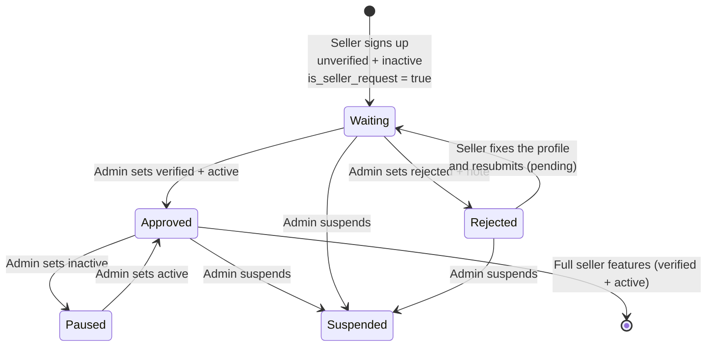

# Seller Account API Guide — sign-up, login and profile

This is the **only** guide for the seller **account** APIs: public location lookups for
the sign-up form, sign-up with KYC documents, seller login, the seller's own profile
(`/seller/me`), resubmit after a rejection, and change password.

- **Plain-language guide** (no API details): `../Egoola_Seller_Guide.md` (the seller
  process).
- **Postman:** `postman/seller/Egoola-SellerApp.postman_collection.json` → **Setup**,
  **Public lookups**, **Seller sign-up**, **Seller — own profile**, **After approval**
  folders, and `postman/Egoola-Local.postman_environment.json`.
- **Smoke tests:** `scripts/smoke/seller_self_smoke.sh`, `public_geography_smoke.sh`,
  and the sign-up part of `seller_onboarding_smoke.sh`.
- **Not in this guide:**
  - **The seller's products, gigs and job bidding** —
    [`seller-listing-api-guide.md`](seller-listing-api-guide.md),
    [`seller-gig-api-guide.md`](seller-gig-api-guide.md),
    [`seller-job-bidding-api-guide.md`](seller-job-bidding-api-guide.md).
  - **The seller's orders** — [`seller-order-api-guide.md`](seller-order-api-guide.md).
  - **The admin side** (seller list, filters, Seller Request queue, approve / reject,
    profile change history). That is in
    [`../admin/seller-verification-guide.md`](../admin/seller-verification-guide.md)
    and [`../frontend-api-guide.md`](../frontend-api-guide.md) §8, with the collection
    `Egoola-Seller.postman_collection.json`.
- Every example below is a real response from the running server.

---

## Table of contents

- [1. The big picture](#1-the-big-picture)
  - [A seller's life](#a-sellers-life)
  - [Two switches, not one](#two-switches-not-one)
  - [What each state can do](#what-each-state-can-do)
  - [The seller-facing endpoints](#the-seller-facing-endpoints)
- [2. Public lookups for the sign-up form (no login)](#2-public-lookups-for-the-sign-up-form-no-login)
- [3. Seller sign-up (public)](#3-seller-sign-up-public)
  - [Fields](#fields)
  - [Documents (`media_for` + `media_file`)](#documents-media_for-media_file)
  - [Business profile (`info`, optional)](#business-profile-info-optional)
  - [Example (browser code)](#example-browser-code)
  - [Success — `201`](#success-201)
  - [Errors — `400`](#errors-400)
- [4. Login](#4-login)
- [5. The seller's own profile — `/api/v1/seller/me/`](#5-the-sellers-own-profile-apiv1sellerme)
  - [5.1 Read — `GET /api/v1/seller/me/`](#51-read-get-apiv1sellerme)
  - [5.2 Edit — `PATCH /api/v1/seller/me/`](#52-edit-patch-apiv1sellerme)
  - [5.3 Documents](#53-documents)
  - [5.4 Resubmit after a rejection — `POST /api/v1/seller/me/resubmit/`](#54-resubmit-after-a-rejection-post-apiv1sellermeresubmit)
  - [5.5 Change password — `POST /api/v1/seller/me/change-password/`](#55-change-password-post-apiv1sellermechange-password)
- [6. What a seller who cannot operate can NOT do](#6-what-a-seller-who-cannot-operate-can-not-do)
- [7. Rules in one place](#7-rules-in-one-place)
- [8. Not built yet](#8-not-built-yet)
- [9. Try it](#9-try-it)

---

## 1. The big picture

### A seller's life



Every state in this diagram can log in — `status`/`verification_status` decide what the seller can *do* once
logged in (the three tiers below), not whether they can log in at all.

### Two switches, not one

A seller has two separate fields. Do not mix them up:

| Field | Values | Meaning |
|---|---|---|
| `verification_status` | `unverified`, `pending`, `verified`, `rejected` | The **KYC decision**. A seller is **approved** when this is `verified`. |
| `status` | `active`, `inactive`, `suspended` | The **account switch**. **Every value can log in** (see "Three tiers" below — `status` no longer gates login by itself). `status` is partly derived from `verification_status`: `pending` and `rejected` force it (see the admin guide's "Transition and status rules"); `unverified` can only be `inactive`/`suspended`; `verified` is free. |

`can_operate` = `verified` **and** `active` — the **full** tier (listings, gigs, job bidding, orders, wallet...).
Every seller who isn't there falls into one of two narrower tiers below, both reported on the seller row as
booleans so the app never has to re-derive them.

### Three tiers, not two

There used to be a simple "can operate / can't" split. There are now three tiers, reported as two booleans:

| Tier | `can_operate` | `can_edit_profile` | What they can do |
|---|---|---|---|
| **Full** | `true` | `true` | Everything — listings, gigs, job bidding, orders, wallet, and their own profile. |
| **Profile-only** | `false` | `true` | Only `/seller/me/...` — read/edit their profile and documents, change password, (if `rejected`) resubmit. Everything else is `403`. |
| **Locked** | `false` | `false` | Logged in, can read `GET /seller/me/`, but every write — including editing their own profile — is `403`. |

### What each reachable state falls into

| `verification_status` + `status` | Can log in? | Tier |
|---|---|---|
| `unverified` + `inactive` (just signed up) | yes | Profile-only |
| `unverified` + `suspended` | yes | **Locked** |
| `pending` + `inactive` (resubmitted, awaiting review) | yes | Profile-only |
| `rejected` + `suspended` | yes | **Profile-only — deliberate carve-out.** `rejected` always comes with `status: suspended` (forced), but a rejected seller still has to fix their profile/documents and resubmit, or they'd be locked out forever. Nothing else is carved out: full-feature endpoints stay `403`. |
| `verified` + `active` (**can operate**) | yes | **Full** |
| `verified` + `inactive` (approved, then **paused** by an admin) | yes | **Locked** — pausing an already-approved seller locks them out entirely, not just down to profile-only. |
| `verified` + `suspended` | yes | **Locked** |

The server loads the seller fresh on every request, so a change to either field takes effect immediately, not when
the token expires. Every seller feature (listings, gigs, job bidding, orders, wallet...) is built behind a
`can_operate` check (full tier only); `/seller/me/...`'s writes are behind a `can_edit_profile` check (profile-only
or full); its `GET` is open to any logged-in seller, even a locked one.

### The seller-facing endpoints

| Who | Endpoint | What |
|---|---|---|
| Anyone | `GET /api/v1/public/geography/{countries,states,cities,thanas}/` | Location dropdowns (section 2) |
| Anyone | `POST /api/v1/auth/seller/register/` | Sign up with documents (section 3) |
| Seller | `POST /api/v1/auth/seller/login/` | Log in (section 4) |
| Seller | `GET`, `PATCH /api/v1/seller/me/` | Own profile (section 5) |
| Seller | `POST /api/v1/seller/me/resubmit/` | Resubmit after a rejection (section 5.4) |
| Seller | `POST /api/v1/seller/me/change-password/` | Change own password (section 5.5) |
| Seller (can operate) | products, gigs, job bidding, orders | See [`seller-listing-api-guide.md`](seller-listing-api-guide.md), [`seller-gig-api-guide.md`](seller-gig-api-guide.md), [`seller-job-bidding-api-guide.md`](seller-job-bidding-api-guide.md), [`seller-order-api-guide.md`](seller-order-api-guide.md) |

What an admin does with these sellers (review the documents, approve, reject) is in the admin guide. Where this guide
says "an admin approves", the admin does it with `PATCH /accounts/sellers/{id}/`
(`{"verification_status": "verified", "status": "active"}`).

---

## 2. Public lookups for the sign-up form (no login)

The country / state / city / thana lists are public routes, documented in [`../public-api-guide.md`](../public-api-guide.md) section 2 (no token, `GET` only, sorted by name,
`limit` default 500). Load them one level at a time (`states/?country=`, `cities/?state=`, `thanas/?city=`); an empty list is normal. `business_type`, `employees_range` and
`annual_revenue` (business profile) are free text: the frontend decides which choices to offer.

---

## 3. Seller sign-up (public)

**`POST /api/v1/auth/seller/register/`**

- No token needed. Send **`multipart/form-data`** (it carries files; a plain JSON
  request cannot carry the NID). A token sent by mistake is ignored.

### Fields

| Field | Required | Notes |
|---|---|---|
| `name` | yes | |
| `email` | yes | Must be new. Upper and lower case count as the same email. (Not used to log in.) |
| `phone` | yes | Must be new. **This is the number the seller logs in with.** |
| `password` | yes | At least 8 characters, not a very common password, not all digits. |
| `present_address` | yes | Text. |
| `permanent_address` | yes | Text. |
| `country`, `state`, `city` | yes | Ids from the public lookups (section 2). The state must belong to the country, the city to the state. |
| `thana` | no | Id. If sent, it must belong to the city. |
| `media_for` + `media_file` | yes | The documents (below). |
| `profile_pic` | no | One image file. |
| `info` | no | The business profile, as a JSON **string** (below). |

### Documents (`media_for` + `media_file`)

Send them as pairs. The 1st `media_for` goes with the 1st `media_file`, the 2nd with
the 2nd, and so on. Both lists must be the same length.

- `media_for` can be `nid`, `birth_certificate`, `certificate` or `other`.
- **At least one `nid` is required.** A seller with a front and back scan sends two `nid` pairs.
- Each file must be **JPG, PNG, WEBP or PDF**, and **5 MB or smaller**.
- At most **10** files in one request.

```
media_for:   nid
media_file:  <front.jpg>
media_for:   nid
media_file:  <back.jpg>
media_for:   certificate
media_file:  <trade-licence.pdf>
```

### Business profile (`info`, optional)

A JSON string in the form. If you send it, six fields are required: `business_type`,
`main_product`, `owner_name`, `employees_range`, `annual_revenue`, `established_year`.
Optional: `description`, `public_email`, `whatsapp`, `facebook`, `wechat`, `skype`, and
`country`, `state`, `city`, `thana` (same location rule). A half-filled `info` is a `400`.
The seller can also add it later with `PATCH /seller/me/` (section 5).

```json
{
  "business_type": "Retail",
  "main_product": "Shoes",
  "owner_name": "Rafiq Ahmed",
  "employees_range": "1-10",
  "annual_revenue": "< $50,000",
  "established_year": "2020"
}
```

### Example (browser code)

```js
const form = new FormData();
form.append("name", "Rafiq Ahmed");
form.append("email", "rafiq@example.com");
form.append("phone", "+8801711000111");
form.append("password", "Sell@12345");
form.append("present_address", "House 12, Road 5, Feni Sadar");
form.append("permanent_address", "Village Pashchim Para, Feni");
form.append("country", 126);
form.append("state", 13);
form.append("city", 8);
form.append("media_for", "nid");
form.append("media_file", nidFrontFile);
form.append("media_for", "nid");
form.append("media_file", nidBackFile);

// Do NOT set the Content-Type header yourself. The browser adds it, with the boundary.
const response = await fetch(`${API}/auth/seller/register/`, { method: "POST", body: form });
```

### Success — `201`

```json
{
  "id": 121,
  "name": "Rafiq Ahmed",
  "email": "rafiq@example.com",
  "phone": "+8801711000111",
  "present_address": "House 12, Road 5, Feni Sadar",
  "permanent_address": "Village Pashchim Para, Feni",
  "country": 126,
  "state": 13,
  "city": 8,
  "thana": null,
  "verification_status": "unverified",
  "status": "inactive",
  "is_seller_request": true,
  "message": "Registration received. An admin will review your documents. You can log in now to complete your profile; you can start selling once your account is approved and active."
}
```

There is **no token** in the response. The seller can log in right away (section 4) to complete their profile,
so send them to the login page, or to a "thank you, we will review it" screen with a login button.
`verification_status`, `status` and `is_seller_request` cannot be chosen by the client;
if a form sends them, they are ignored.

### Errors — `400`

Same shape as every endpoint: `{ "field": ["message", ...] }`.

| Problem | Error key | Message |
|---|---|---|
| A required field is missing | the field name | `This field is required.` |
| Email already used | `email` | `seller with this email already exists.` (same text if only the case differs) |
| Phone already used | `phone` | `seller with this phone already exists.` |
| Weak password | `password` | `This password is too short...` (a list) |
| State not in the country, city not in the state | `state` / `city` / `thana` | `This city does not belong to the selected state.` |
| No `media_for` / `media_file` at all | `media_for`, `media_file` | `This field is required.` |
| Different number of `media_for` and `media_file` | `media_for` | `Provide exactly one media_for value for each media_file, in the same order.` |
| No `nid` among the documents | `media_for` | `At least one NID document is required (media_for = nid).` |
| Wrong file type | `media_file` | `note.txt: only JPG, PNG, WEBP or PDF files are accepted.` |
| File over 5 MB | `media_file` | `big.png: each file must be 5 MB or smaller.` |
| More than 10 files | `media_file` | `Upload at most 10 documents.` |
| Profile picture is not a real image | `profile_pic` | |
| Incomplete business profile | `info` | the missing business fields |

A failed sign-up saves nothing: no seller row and no half-uploaded files are left behind.
A seller who was **rejected** cannot sign up again with the same phone or email (they are
taken). They log in, fix their details and use **resubmit** (section 5.4).

---

## 4. Login

**`POST /api/v1/auth/seller/login/`** with `{ "phone", "password" }`.

**A seller logs in with their phone number and password, not their email.** (Admins and buyers still use email.) The
phone number is exactly the one given at sign-up (the server ignores spaces around it). Sending `email` instead of `phone`
is `400 {"phone": ["This field is required."]}`. Because the phone number is the login, an admin who changes a seller's
phone number changes how that seller logs in: the old number stops working at once.

**Every seller can log in, including a locked one.** The response tells the app which of the three tiers (above) to
show:

```json
{
  "access": "eyJhbGciOiJIUzI1NiIs...",
  "refresh": "eyJhbGciOiJIUzI1NiIs...",
  "actor_type": "seller",
  "id": 211,
  "name": "Rafiq Ahmed",
  "email": "smoke.guide@example.com",
  "phone": "+8801700096001",
  "verification_status": "unverified",
  "status": "inactive",
  "can_operate": false,
  "can_edit_profile": true
}
```

What to do in the app:

- `can_operate: true` → the normal seller app.
- `can_operate: false`, `can_edit_profile: true` → profile screens only (profile form, documents, change password).
  Choose the message from `verification_status`:
  - `unverified` or `pending` → "Your application is under review."
  - `rejected` → show the reason (`GET /seller/me/` → `verification_note`) and a **Resubmit** button.
- `can_operate: false`, `can_edit_profile: false` → **locked**: show `GET /seller/me/`'s data read-only, no edit
  screens at all. "Your account is suspended. Contact support." (this is `verified + inactive`, i.e. a paused
  approved seller, or `suspended` under any `verification_status` other than `rejected`).
- A wrong password **or an unknown phone number** is `401 {"detail": "Invalid phone number or password."}` (the same message
  for both, so nobody can find out which numbers are registered).

Tokens, refresh and error shapes are the same as everywhere else: see
`../frontend-api-guide.md` §3–4 and `../authentication.md`.

---

## 5. The seller's own profile — `/api/v1/seller/me/`

`GET` is open to any logged-in seller, including a **locked** one. `PATCH` (and 5.4/5.5 below) need
`can_edit_profile: true` — a locked seller gets `403 {"detail": "Your seller account is locked. Contact support."}`.
Send `Authorization: Bearer <access>`. An admin or buyer token gets `403`.

### 5.1 Read — `GET /api/v1/seller/me/`

```json
{
  "id": 211,
  "name": "Rafiq Ahmed Khan",
  "email": "smoke.guide@example.com",
  "phone": "+8801700096001",
  "profile_pic_url": null,
  "present_address": "Shop 4, Trunk Road, Feni",
  "permanent_address": "Village Pashchim Para, Feni",
  "country": 126, "state": 13, "city": 8, "thana": null,
  "skills": null, "education": null, "experience": null, "interest": null,
  "media": [
    { "id": 176, "media_type": "image", "media_for": "nid",
      "media_path": "seller/nid/26a72124a475432c956f6fcd55d766aa.png",
      "media_url": "/media/seller/nid/26a72124a475432c956f6fcd55d766aa.png" }
  ],
  "business_info": {
    "business_type": "Retail", "main_product": "Bags", "owner_name": "Rafiq Ahmed",
    "employees_range": "1-10", "annual_revenue": "< $50,000", "established_year": "2020",
    "description": null, "public_email": null, "whatsapp": null, "facebook": null,
    "wechat": null, "skype": null, "country": null, "state": null, "city": null, "thana": null
  },
  "verification_status": "unverified",
  "verification_note": null,
  "status": "inactive",
  "is_seller_request": true,
  "can_operate": false,
  "can_edit_profile": true,
  "created_at": "2026-10-11T22:38:52.250133+06:00",
  "requested_at": "2026-10-11T22:38:51.947603+06:00"
}
```

- `verification_note` is the admin's reason when the seller was rejected. Show it.
- No password, wallet or change log is returned here.
- `media_url` is a path on a local server (`/media/...`): put the server address in front.
  In production it is a full, short-lived signed URL.

### 5.2 Edit — `PATCH /api/v1/seller/me/`

Send only the fields that change. Use JSON for text fields and **multipart/form-data**
when a file is included.

| Field | Editable? | Notes |
|---|---|---|
| `name` | yes | Not blank. |
| `profile_pic` | yes | One image (file). |
| `present_address`, `permanent_address` | yes | Not blank. |
| `country`, `state`, `city`, `thana` | yes | Must match each other (same rule as sign-up). `country`/`state`/`city` cannot be null. |
| `skills`, `education`, `experience`, `interest` | yes | Free JSON (lists). |
| `info` | yes | The business profile. Send the whole object; six fields required (section 3). Read back as `business_info`. |
| `media_for` + `media_file`, `media_delete_ids` | yes | Documents (5.3). |
| `email`, `phone` | **no, for now** | The same value is accepted; a different one is `400`: `{"email": ["Email cannot be changed."]}`. |
| `verification_status`, `verification_note`, `status`, `is_seller_request`, `can_operate`, `can_edit_profile`, `created_at`, `requested_at` | **never** | Read-only. Sending them changes nothing: a seller cannot approve themselves. |

Returns `200` with the same body as `GET /seller/me/`. A **locked** seller never reaches this far — `403` before
validation even runs (see the tier table above).

Every real change is written to a **profile change log** that admins read on the seller detail (the seller does
not see it). Sending the same values again writes nothing.

### 5.3 Documents

Same pairs as sign-up: `media_for` (`nid`, `birth_certificate`, `certificate`, `other`) and
`media_file` (JPG / PNG / WEBP / PDF, 5 MB each, 10 per request). To remove a document,
send its `id` (from `media`) in `media_delete_ids`. To replace one, delete the old one
and upload the new one **in the same request**.

**Who can change which document, and when**

| Seller's verification | NID, birth certificate | Certificates and "other" documents |
|---|---|---|
| `unverified`, `pending` or `rejected` (not approved yet) | **Can add, delete and replace** (at least one NID must always remain) | Can add, delete and replace |
| `verified` (approved), active **or** inactive | **Locked.** Only an admin can change them | Can add, delete and replace |

The first row is on purpose: a **rejected** seller has to be able to fix a blurry or wrong NID before they resubmit. The
second row protects the identity check that was already done. An admin is never blocked by the lock.

Rules:

- **At least one NID must always remain.** Deleting the only NID without uploading a new
  one in the same request is `400`: `At least one NID document is required. Upload the new NID in the same request.`
- **After verification, identity documents are locked.** A verified seller cannot add or
  delete `nid` or `birth_certificate` documents: `400 {"media_for": ["Your identity documents (NID, birth certificate) are locked after verification. Ask an admin to change them."]}`.
  Other documents (`certificate`, `other`) and every other field stay editable.
- A seller can only touch their own documents. An id that belongs to someone else is ignored.
- **Deleted files are really deleted.** When a document is deleted (or replaced), or a profile photo is replaced, the
  old file is removed from storage as soon as the change is saved. A refused request (for example, deleting the only
  NID) keeps the file.
- Errors for file type, size and count are the same as at sign-up.

```
PATCH /api/v1/seller/me/        (multipart/form-data)
media_delete_ids:  176
media_for:         nid
media_file:        <new-nid.jpg>
```

### 5.4 Resubmit after a rejection — `POST /api/v1/seller/me/resubmit/`

A rejected seller logs in, reads the reason (`verification_note`), fixes their details and
documents with `PATCH /seller/me/`, then resubmits. Body (optional): `{ "note": "..." }`,
at most 1000 characters: a message to the reviewer.

What happens:

- `verification_status` becomes **`pending`**, `is_seller_request` becomes `true` and
  `requested_at` becomes now, so the seller is back in the admin's Seller Request queue,
  as the **newest** request (admin side: `../admin/seller-verification-guide.md`).
- The seller's `note` becomes `verification_note` (the note on the row always belongs to
  the current status). The admin's rejection reason stays in `verification_logs`.
- A history entry is added, made by the seller (`creator_type: "seller"`).
- `status`, which was `suspended` while `rejected`, becomes `inactive` — `pending` always forces that (same as an
  admin setting `pending` directly). The seller comes out of resubmit back in the **profile-only** tier, not locked.
  An admin still has to approve with `verified` + `active` to reach full.

Only a **rejected** seller can resubmit; anyone else gets
`400 {"detail": "Only a rejected application can be resubmitted."}` (this includes a
seller who is already `pending`). The response is the same body as `GET /seller/me/`.

### 5.5 Change password — `POST /api/v1/seller/me/change-password/`

```json
{ "current_password": "Sell@12345", "new_password": "Better@2468" }
```

- `200 {"detail": "Password changed."}`. The current token keeps working.
- `400` for a wrong `current_password` (`Incorrect password.`), a weak or reused
  `new_password` (it must follow the password rules and differ from the current one).
- The change is logged for admins, but the password itself is never stored in the log.

---

## 6. What a seller who cannot operate can NOT do

Everything outside `/seller/me/...`. Products, gigs, job bidding, orders, wallet and withdrawals all need a
seller who **can operate** (verified **and** active) — see
[`seller-listing-api-guide.md`](seller-listing-api-guide.md),
[`seller-gig-api-guide.md`](seller-gig-api-guide.md),
[`seller-job-bidding-api-guide.md`](seller-job-bidding-api-guide.md) and
[`seller-order-api-guide.md`](seller-order-api-guide.md). Everyone else gets `403` with a message that says which
tier is holding them back:

- locked (`can_edit_profile: false` — `verified + inactive`, or `suspended` under anything except `rejected`):
  `{"detail": "Your seller account is locked. Contact support."}`
- not verified yet (profile-only: unverified, pending, or the `rejected` carve-out):
  `{"detail": "Your seller application is not approved yet. You can only edit your profile until an admin approves it."}`

Admin endpoints (`/accounts/...`) are always `403` for a seller, whatever their state.

---

## 7. Rules in one place

| Rule | |
|---|---|
| Sign-up always creates `unverified`, `inactive`, `is_seller_request = true`, `requested_at` = now | server |
| The client cannot choose status, verification or the flag | read-only fields |
| Sign-up needs at least one NID; JPG/PNG/WEBP/PDF, 5 MB, 10 files | server |
| Email unique ignoring case; phone unique | server |
| Country / state / city / thana must match each other | server (everywhere) |
| Password: 8+ characters, not common, not all digits | server |
| Three tiers: full (`can_operate`) can use everything; profile-only (`can_edit_profile`, not `can_operate`) can only use `/seller/me/...`; locked (neither) can only `GET /seller/me/` | `IsSellerActor` / `IsProfileEditableSellerActor` / `IsActiveVerifiedSellerActor` |
| Every status can log in now, including `suspended` — it's a post-login tier (above), not a login-time block | login + every request |
| A seller logs in with **phone number + password** (not email); an admin changing the phone changes the login | login |
| Email and phone cannot be changed by the seller (for now) | `/seller/me/` |
| Identity documents (NID, birth certificate) locked once `verified`; at least one NID always | `/seller/me/` |
| Only a `rejected` seller can resubmit; result is `pending` + back in the queue | `/seller/me/resubmit/` |
| Every real profile change is logged (before and after) for admins | change log |

---

## 8. Not built yet

Do not build screens against these:

- **Email / phone verification (OTP).** The columns exist but there is no endpoint;
  `email_verified` and `phone_verified` are `false` for everyone.
- **Changing email or phone** (the seller cannot, for now).
- **Notifications** (email or push) when a seller is approved, rejected or resubmits.
- **Rate limiting** on the public sign-up endpoint: put a limit in front of it before launch.
- **Per-document verification** (accept the NID, ask for a new certificate): verification is
  one decision for the whole seller.
- **Seeing the change history as a seller:** only admins see it, on the seller detail.

---

## 9. Try it

1. Start the server: `uv run manage.py runserver 8000`.
2. Import `postman/seller/Egoola-SellerApp.postman_collection.json` and `postman/Egoola-Local.postman_environment.json`.
3. Run the folders in order: Setup (admin token), Public lookups, Seller sign-up, Seller — own profile, After approval.
   Requests named **[Admin step]** are not seller APIs: they play the admin so you can see
   what a seller sees (an approval, a rejection, a suspension). In every request with a file row, choose a real
   JPG, PNG or PDF in Postman.

Or from a terminal: `scripts/smoke/seller_self_smoke.sh`, `seller_onboarding_smoke.sh`, `public_geography_smoke.sh`.
